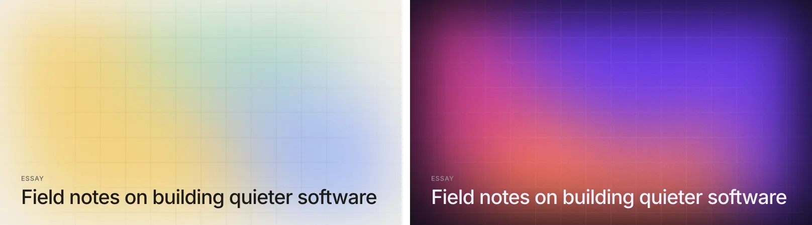
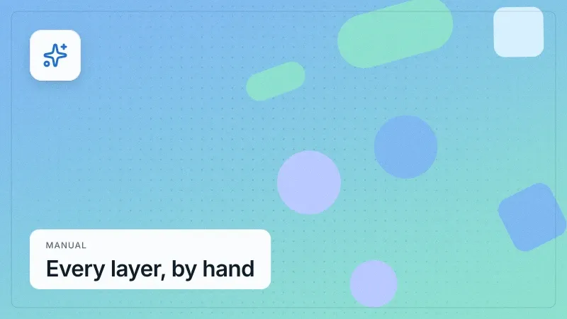
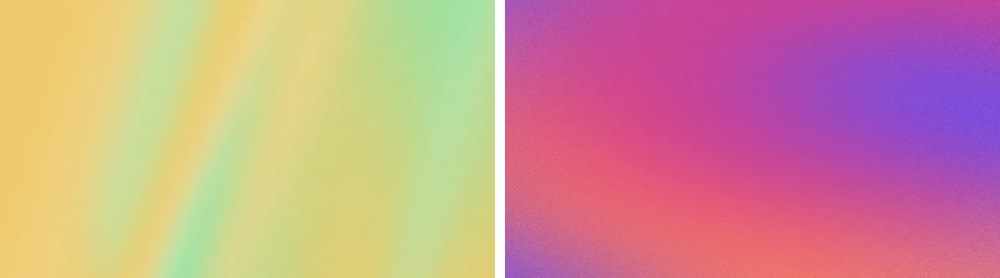
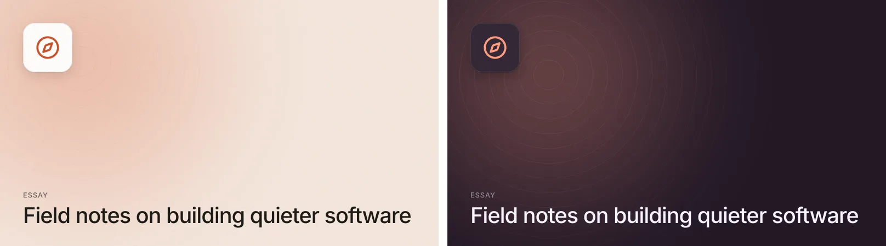
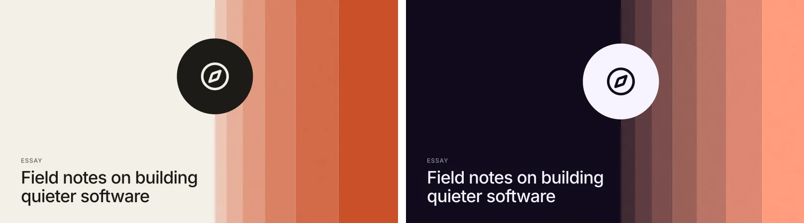

# @arraypress/covers

Build-time cover images for posts, products and pages: soft mesh gradients, film grain, fine grids, stripes, shapes, icons and type, drawn from one **seed**. The same slug always gives the same image, and two posts never look alike.

Six recipes cover the editorial looks (openai.com/news gradients, claude.com stripe bands, a clean icon tile, big type, duotone photos), and every layer under them is yours to change, remove or add to. Output is an SVG string (text as outlines, so it needs no fonts) or WebP / PNG / AVIF / JPEG via [sharp](https://sharp.pixelplumbing.com). Inter ships in the package, so it works with no setup. There's an Astro helper that turns a content collection into static covers in three lines.

No network, no telemetry, no DOM. It runs in Node at build time.



## Install

```bash
npm install @arraypress/covers sharp
# optional, for icons by name:
npm install @iconify-json/lucide @iconify-json/simple-icons
```

`sharp` is needed for `renderImage()`. `renderSvg()` works without it.

## Quick start

```js
import { renderImage } from '@arraypress/covers';
import { writeFile } from 'node:fs/promises';

const webp = await renderImage({
  recipe: 'gridTitle',
  seed: 'introducing-covers',          // the post's slug
  title: 'Introducing covers',
  label: 'Product',
  palette: 'dusk',
  aspect: '16:9',
});
await writeFile('public/covers/introducing-covers.webp', webp);
```

Or build the stack yourself:

```js
const svg = await renderSvg({
  seed: 'hello',
  palette: ['#0c0d12', '#3d5afe', '#ff6b3d', '#9b4dff'], // [bg, ...colors]
  layers: [
    { type: 'mesh', blur: '12vmax' },
    { type: 'pattern', kind: 'grid', fade: 'edges' },
    { type: 'grain', amount: 0.08 },
    { type: 'text', content: 'Hello', anchor: 'bottom-left', size: 96 },
  ],
});
```



## API

| Export | |
|---|---|
| `cover(options)` | Resolve size and palette and expand the recipe into a layer stack. Pure, synchronous; returns plain data you can inspect or tweak. |
| `renderSvg(cover)` | `Promise<string>`: an SVG document. Byte-identical for the same input. |
| `renderImage(cover, { format, quality, effort, cache })` | `Promise<Buffer>`: `'webp'` (default), `'png'`, `'avif'` or `'jpeg'`. |
| `coverKey(cover, options)` | The content-hash cache key (see [Caching](#caching)). |
| `recipes` | The built-in recipes, by name. |
| `palettes`, `resolvePalette(input)`, `derivePalette(tokens)` | Palettes (see [Palettes](#palettes)). |
| `registerIcons(iconifySet)` | Use an icon set without installing its package. |
| `toHex`, `toOklch`, `fromOklch`, `mixOklab` | Colour helpers. |
| `createRng(seed)`, `hashString(str)` | The seeded randomness, for custom recipes. |
| `resolveSize`, `ASPECTS`, `MIME`, `DEFAULT_QUALITY`, `VERSION` | |

### Cover options

| Option | Default | |
|---|---|---|
| `seed` | the title | Drives every random choice. Use the slug. |
| `width` / `height` / `aspect` | 1200×1200 | `aspect`: `'1:1'`, `'16:9'`, `'4:5'`, `'3:2'`, `'4:3'`, `'2:1'`, `'9:16'`, `'og'` (1200×630), any `'w:h'`, or a number. One side plus an aspect gives the other. |
| `palette` | `'paper'` | A preset, one colour, `[bg, ...colors]`, an object, or `derivePalette()`. |
| `recipe` | — | A recipe name or your own function. |
| `layers` | mesh + grain | Without a recipe: the stack. With one: extra layers on top. |
| `fonts` | Inter | `[{ name, data, weight, style }]`, `.ttf`/`.otf`/`.woff` (not woff2). Inter 400/500/600/700 is always available. |
| `alt` | the title | The SVG's `<title>`. |
| `radius` | — | Rounded corners, transparent outside. |
| any layer id | — | Customise a recipe's layer (see [Recipes](#recipes)). |

### Lengths

Sizes are pixels as numbers, or viewport units of the cover as strings: `'6vmin'` (6% of the shorter side), `'4vw'`, `'4vh'`, `'5vmax'`. Defaults use these, so a cover keeps its proportions at any size. Positions (`x`, `y`, `region`) are fractions of the canvas, 0–1.

## Layers

Layers paint bottom first. Every option has a default drawn from the palette, the canvas and the layer's own seeded stream, so `{ type: 'mesh' }` alone is a finished background. Every layer also takes `id` (for overrides), `seed` (its own stream), `opacity` and `blend` (a CSS `mix-blend-mode`).

A layer's random stream is keyed by its `seed`, else its `id`, else its type and position among layers of that type, so adding a layer never reshuffles the others.

### `solid`
`color` (default `bg`).

### `linear`
`colors` (default the first two palette colours), `opacities` (per stop), `angle` (CSS degrees, 0 = up; default seeded), `ease` (default `true`: smoothstep stops mixed in OKLab, so there's no hard edge where the gradient starts and ends).

### `radial`
`colors` (centre → edge; default `[colors[0], bg]`), `x`, `y` (default seeded), `radius` (default `'80vmax'`), `ease`.

### `mesh`
Blurred blobs of colour over a base: the mesh-gradient look.

| Option | Default | |
|---|---|---|
| `colors` | the palette's | |
| `hues` | 3 | How many distinct colours to use. A few hues read as a colour story; every hue at once reads as a rainbow. |
| `count` | 4 | Blobs. |
| `blur` | `'11vmax'` | Gaussian std deviation. |
| `spread` | 0.7 | How far blobs wander from the centre, 0–1. |
| `size` | `[0.3, 0.52]` | Radius range, fractions of the longer side. |
| `base` | `bg` | Fill under the blobs; `null` for none. |
| `blobs` | — | `[{ x, y, r, squash, rotate, color, opacity }]` to place them yourself. |

Blobs sit on a jittered ring (so they don't clump), each a rotated ellipse.

### `stripes`
`direction` (`'vertical'` default, `'horizontal'`, `'diagonal'` + `angle`), `count` (8), `widths` (`'even'`, `'random'`, `'taper'` with `taper` ratio 0.78, or weights like `[3, 2, 1]`), `colors` (cycled), `gap`, `radius`, `region` (fractions; default the whole canvas), `regionRadius`.

### `image`
`src` (a local path, a `data:` URI or bytes; URLs are refused), `fit` (`'cover'` / `'contain'`), `focus` (an anchor, or `'attention'` / `'entropy'` smart crops), `region`, `duotone` (`true` derives shadow and highlight from the palette, or `[shadow, highlight]`), `grayscale`, `normalize` (stretch tones first; on by default with duotone/grayscale), `tint` (a colour, or `{ color, amount, blend }`), `blur`.

With sharp installed the image is cropped and resized to its box before embedding. Without it, PNG, JPEG and SVG are embedded as they are.

### `grain`
`amount` (0.08), `size` (px per grain, 1), `monochrome` (`true`), `blend` (`'overlay'`; also `'soft-light'`, `'multiply'`, `'screen'`, `'normal'`).

### `pattern`
`kind`: `'grid'` (default), `'dots'`, `'lines'` (+ `angle`), `'rings'`, `'waves'` (+ `wavelength`, `amplitude`). `size` (cell; `'8.33vmin'`), `stroke`, `color` (`text`), `opacity` (0.14), `center` (rings and grid alignment), `fade` (`'none'`, `'radial'`, `'edges'`, `'top'`, `'bottom'`, `'left'`, `'right'`), `region`.

Grid lines are drawn across the canvas, not as an SVG `<pattern>` (which clips a line on a tile edge to half its width), and centred.

### `shapes`
`kind` (`'circle'`, `'square'`, `'pill'`, `'mixed'`), `count` (6), `size` (`['7vmin', '20vmin']`), `colors`, `placement` (`'scatter'` spreads them out avoiding overlaps; `'row'`, `'column'`), `items` (`[{ kind, x, y, size, color, rotate, opacity }]`), `region`, `rotate`, `radius` (squares, fraction of size), `outline` (`true` or a width).

### `icon`
One of `name` (Iconify: `'lucide:feather'`, `'simple-icons:github'`), `svg` (a raw SVG string; scripts and handlers are stripped) or `path` (+ `viewBox`). `size` (`'24vmin'`, `'15vmin'` on a tile), `color` (the accent on a tile, else `text`), `strokeWidth`, `anchor`, `position`, `offset`, `margin`, and `tile` (`true` or `{ size, radius, color, shadow: 'soft' | 'none', border }`).

Named icons load from `@iconify-json/<prefix>` (resolved from your project), or from a set you pass to `registerIcons()`.

### `text`
Set as outlines, so the SVG needs no fonts.

| Option | Default | |
|---|---|---|
| `content` | — | `\n` breaks a line. |
| `font`, `weight`, `style` | `'Inter'`, 600 | The closest weight in the family wins. |
| `size` | 6% of `sqrt(w × h)` | |
| `minSize` | — | Shrink toward this before truncating. |
| `lineHeight` | 1.12 | |
| `letterSpacing` | -0.02 | Em. Tighten big type further (`-0.045`). |
| `color` | `text` | |
| `anchor` | `'bottom-left'` | Nine anchors, inside the safe `margin` (7% of `sqrt(w × h)`). |
| `align` | from the anchor | |
| `position`, `offset` | — | |
| `maxWidth` | width less margins | |
| `maxLines` | 3 | Past it, cut at a word with `ellipsis` (`'…'`). |
| `balance` | `true` | Even line lengths (CSS `text-wrap: balance`). |
| `transform` | — | `'uppercase'` / `'lowercase'`. |
| `label` | — | A small line above: a string, or `{ content, size, weight, color, letterSpacing, transform, gap }` (uppercase, tracked, `muted` by default). |
| `background` | — | A pill or box behind: a colour, or `{ color, radius, padding, opacity }`. |

Text is shaped by [HarfBuzz](https://harfbuzz.github.io) (kerning, ligatures, any script the font covers) and trimmed to the cap height above and the baseline below, so a margin measured to a headline is the margin you see. A word wider than the line breaks between characters. Pass a font that covers your script for non-Latin titles (the bundled Inter is a Latin subset).

### `frame`
`inset` (`'3.5vmin'`), `radius` (`'2vmin'`), `stroke` (`'0.15vmin'`), `color` (`text`, at opacity 0.22), `fill` (a colour, to make a card).

## Recipes

A recipe returns a stack of layers with ids. Customise any of them by id:

- a **string** is the layer's content: `title: 'Hello'`, `icon: 'lucide:feather'`
- an **object** is merged into the layer: `mesh: { blur: '16vmax' }`, `title: { content: 'Hello', size: 96 }`
- **`false`** removes it: `grain: false`

```js
await renderImage({
  recipe: 'gridTitle',
  seed: post.slug,
  title: post.title,
  mesh: { hues: 2, blur: '14vmax' },
  grid: { kind: 'dots' },
  layers: [{ type: 'frame' }], // painted on top
});
```

Every recipe takes an optional `title` and `label`.

### `aurora`
Layers `bg`, `mesh`, `grain` (+ `title`). A soft mesh with grain.



### `gridTitle`
Layers `bg`, `mesh`, `grid`, `grain`, `title`. A mesh under a fine grid that fades toward the edges, with the headline lower left.


### `iconTile`
Layers `bg`, `glow`, `rings`, `icon`, `grain` (+ `title`). An icon on a raised tile over a soft tint of the accent, a glow and faint rings. With a title, the tile moves to the top left. `icon` is an Iconify name (a spark when none is given).



### `bigType`
Layers `bg`, `wash`, `grain`, `label`, `title`. The headline is the cover: large, tight (−0.045em), shrinking to fit four lines; the label in the accent at the top.


### `stripes`
Layers `bg`, `stripes`, `spot`, `icon`, `grain`, `title`. A tonal band of tapering stripes down one side (`side: 'left' | 'right'`), a disc riding its edge with an optional `icon`, and the title on the open side.



### `duotone`
Layers `image`, `scrim`, `grain`, `title`. A photo (`image`: a path or bytes) mapped to the palette's shadow and highlight colours, with a scrim under the title.


### Your own

```js
const poster = (o, { palette, rng, u }) => [
  { type: 'solid' },
  { type: 'shapes', count: rng.int(3, 6), kind: 'circle' },
  { type: 'text', content: o.title, size: u * 0.1, anchor: 'top-left' },
];
await renderSvg({ recipe: poster, seed: 'x', title: 'Hello' });
```

## Palettes

| Input | Means |
|---|---|
| `'dusk'` | A preset: `paper`, `ink`, `dawn`, `dusk`, `ocean`, `ember`, `moss`, `carbon`, `mono`. |
| `'#2563eb'` | One colour: an accent to derive a palette from. |
| `['#0c0d12', '#3d5afe', '#ff6b3d']` | `[bg, ...colors]`. |
| `{ bg, colors, text, accent, muted, surface }` | Any subset; the rest is derived. |

Resolved, a palette has `mode`, `bg`, `colors`, `text` (7:1 on `bg` when derived), `accent`, `muted` and `surface`.

From a theme's tokens:

```js
import { derivePalette } from '@arraypress/covers';

const palette = derivePalette({ accent: '#2563eb', bg: '#fdfdfd', text: '#1d1d1f' });
// or just: derivePalette({ accent: 'rgb(209 254 23)', mode: 'dark' })
```

The gradient colours are built in OKLCH around the accent's hue (the accent, two neighbours ±40° and a quiet complement), pastel on light backgrounds and deep on dark ones. Colours can be hex, `rgb()` or `hsl()`; alpha is ignored.

## Astro

```ts
// src/pages/covers/[slug].webp.ts
import { getCollection } from 'astro:content';
import { coverEndpoint } from '@arraypress/covers/astro';

export const { getStaticPaths, GET } = coverEndpoint({
  getEntries: () => getCollection('posts'),
  cover: (post) => ({ recipe: 'gridTitle', seed: post.id, title: post.data.title, aspect: '16:9' }),
});
```

`astro build` writes `dist/covers/<id>.webp` for every post; `astro dev` renders on request. Link to one with `coverUrl(post.id)` (→ `/covers/<id>.webp`).

| Option | Default | |
|---|---|---|
| `getEntries` | — | The entries. |
| `cover` | — | An entry's cover options (may be async). |
| `slug` | `entry.id ?? entry.slug` | |
| `param` | `'slug'` | The route param, matching the file name. |
| `format` | `'webp'` | Match the file's extension (`[slug].png.ts` → `'png'`). |
| `quality` | per format | |
| `cache` | `true` | See below. |

Notes:

- Entries with nested ids (`blog/2026/post`) need a rest route: `[...slug].webp.ts`.
- In `output: 'server'`, add `export const prerender = true;` to keep the covers static. On-demand routes also work (the entry is looked up by slug).
- `coverUrl(slug, { base, format })` encodes each path segment.

## Caching

`renderImage(cover, { cache: true })` (the Astro helper's default) stores renders in `node_modules/.cache/covers`, keyed by a SHA-256 of the resolved cover: size, seed, palette, every layer option, font and image bytes (hashed by content), the format, quality and this package's version. An unchanged cover is read back instead of drawn; change anything and it renders again. Pass a directory instead of `true` to put the cache elsewhere (e.g. one your CI restores between builds).

## Performance

Measured on an Apple M3 Max, Node 26, 1200×1200 WebP at the default quality (median of 5):

| Recipe | `renderSvg` | `renderImage` | Size |
|---|---|---|---|
| aurora | 2 ms | 130 ms | 168 KB |
| gridTitle | 1 ms | 140 ms | 143 KB |
| iconTile | 1 ms | 107 ms | 36 KB |
| bigType | 1 ms | 84 ms | 32 KB |
| stripes | 1 ms | 89 ms | 69 KB |
| duotone | 24 ms | 215 ms | 159 KB |

A 1200×630 `og` card is about 70 ms. The first render in a process adds ~80 ms (HarfBuzz's WebAssembly and the fonts load once). Cached covers cost a file read.

How it rasterises, and why:

- **Blur** is SVG `feGaussianBlur`, through sharp's librsvg: ~35 ms for a full 1200×1200 mesh.
- **Grain** is not. librsvg's `feTurbulence` costs ~200 ms at that size, so `renderImage` splits the stack at each grain layer: the layers below are rasterised, seeded noise (a triangular distribution, closer to film than flat noise) is blended in JS with the W3C formulas (~10 ms; sharp's own overlay blend flattens partly transparent noise to almost nothing), and the layers above are composited on top. `renderSvg` keeps `feTurbulence`, which browsers draw quickly; the two grains are matched in strength.
- **Text** is shaped by HarfBuzz (`harfbuzzjs`, a 440 KB WebAssembly build) and written as path data. opentype.js was tried first and dropped: Inter's kerning lives in GPOS extension lookups that neither its 1.x nor 2.x reads, and 2.0 throws on Inter's contextual substitutions.

**Grain versus file size.** Grain is the first thing a lossy encoder throws away. On a cover with grain, WebP quality 82 keeps about 40% of it, 90 about 60%, 94 about 78%, and the file grows each step (a dark aurora: 26 KB at 80, 60 KB at 85, 144 KB at 90; 19 KB at 90 without grain). The default is 90 for WebP (72 AVIF, 88 JPEG). For a grid of small thumbnails, `quality: 80` or `grain: false` is a quarter of the size; for crisp grain, raise it or use PNG.

## Gallery

```bash
npm run gallery
```

renders every recipe × 3 seeds × 2 palettes × 2 aspects into `examples/out/`, with an `index.html` to look through and a contact sheet per recipe. `node examples/docs-images.mjs` rebuilds the images in this README.

## Licence

MIT © ArrayPress Limited. Inter is © The Inter Project Authors, SIL Open Font License 1.1 (`fonts/OFL.txt`). The example photo is from Unsplash (`examples/CREDITS.md`) and isn't published with the package.
