# @arraypress/covers

Cover images, flyers, posters, release art, social formats and print stationery: soft mesh gradients, film grain, riso inks and halftones, knockout and justified type, torn paper, barcodes and more, drawn from one **seed** and a stack of layers. The same slug always gives the same image, and two posts never look alike.

Seventeen recipes cover the editorial looks and a brand kit (full-bleed gradient fields, engineering-blog line diagrams, cut-paper collages, risograph prints, 1-bit dithers, topographic contours, podcast waveforms, Bauhaus grids, magazine issue numbers, palettes from photos, stripe bands, an icon tile, big type, duotone photos, a single-icon mark), and every layer under them is yours to change, remove or add to. Recipes are data: the built-ins are JSON documents, and a theme can write its own cover style the same way, with no JavaScript (see [JSON recipes](#json-recipes)). Output is an SVG string (text as outlines, so it needs no fonts) or WebP / PNG / AVIF / JPEG via [sharp](https://sharp.pixelplumbing.com). Inter ships in the package, so it works with no setup. There's an Astro helper that turns a content collection into static covers in three lines.

No telemetry, no DOM required. It runs in Node at build time, in a browser, and in a Cloudflare Worker (see [Running anywhere](#running-anywhere)); in Node it never touches the network unless you ask.

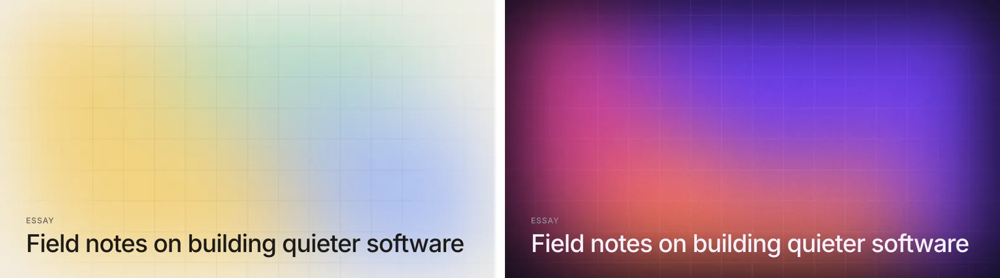

## Install

```bash
npm install @arraypress/covers sharp
# optional, for icons by name:
npm install @iconify-json/lucide @iconify-json/simple-icons
```

`sharp` is needed for `renderImage()`. `renderSvg()` works without it.

## Quick start

```js
import { renderImage } from '@arraypress/covers';
import { writeFile } from 'node:fs/promises';

const webp = await renderImage({
  recipe: 'gridTitle',
  seed: 'introducing-covers',          // the post's slug
  title: 'Introducing covers',
  label: 'Product',
  palette: 'dusk',
  aspect: '16:9',
});
await writeFile('public/covers/introducing-covers.webp', webp);
```

Or build the stack yourself:

```js
const svg = await renderSvg({
  seed: 'hello',
  palette: ['#0c0d12', '#3d5afe', '#ff6b3d', '#9b4dff'], // [bg, ...colors]
  layers: [
    { type: 'mesh', blur: '12vmax' },
    { type: 'pattern', kind: 'grid', fade: 'edges' },
    { type: 'grain', amount: 0.08 },
    { type: 'text', content: 'Hello', anchor: 'bottom-left', size: 96 },
  ],
});
```

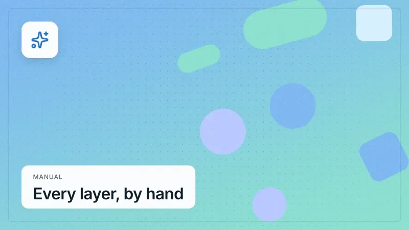

## API

| Export | |
|---|---|
| `cover(options)` | Resolve size and palette and expand the recipe into a layer stack. Pure, synchronous; returns plain data you can inspect or tweak. |
| `renderSvg(cover)` | `Promise<string>`: an SVG document. Byte-identical for the same input. |
| `renderSvg(cover, { t })` | The frame at `t` seconds, for [keyframed](#animation) layers (static covers ignore it). |
| `renderImage(cover, { format, quality, lossless, effort, cache })` | `Promise<Buffer>` (Node, sharp): `'webp'` (default), `'png'`, `'avif'` or `'jpeg'`; `lossless` for WebP/AVIF (default: the recipe's preference). |
| `renderBlob(cover, { format, quality, width })`, `rasterize(svg, options)` | `Promise<Blob>` in the browser: PNG, JPEG or WebP through a canvas. |
| `renderPages(cover)` | `{ front, back }`: both sides of a card, ticket or flyer (see [Pages](#two-sided-pages)). |
| `kit(brand, { formats, recipe })` | A whole brand kit: every format from one brand (see [Brand kit](#brand-kit)). |
| `lint(cover, { target: 'spotify' })` | Release-art checks (see [lint](#lint)). |
| `configure({ load, network, harfbuzz, shaper, icons, fonts })`, `registerFont(font)` | Loading and text, per platform (see [Running anywhere](#running-anywhere)). |
| `FORMATS`, `KIT_FORMATS`, `safeBox(cover)` | Named formats with their safe zones (see [Formats](#formats)). |
| `EFFECTS`, `EFFECT_OPTIONS`, `valueAt(keyframes, t)` | Effect kinds and their options; a keyframed value at a time. |
| `coverKey(cover, options)` | The content-hash cache key (see [Caching](#caching)). |
| `recipes` | The built-in recipes, by name. |
| `defineRecipe(json)`, `loadRecipe(path)` | A recipe from a JSON document or file (see [JSON recipes](#json-recipes)). |
| `palettes`, `resolvePalette(input)`, `derivePalette(tokens)` | Palettes (see [Palettes](#palettes)). |
| `registerIcons(iconifySet)` | Use an icon set without installing its package. |
| `extractPalette(image, { count })` | A photo's dominant colours (k-means in OKLab; needs sharp). |
| `RISO_INKS` | Classic risograph inks by name. |
| `toHex`, `toOklch`, `fromOklch`, `mixOklab`, `mixOklch`, `onBackground`, `gradientAt` | Colour helpers (`onBackground(bgs, 3, 'white')` is the icon-contrast rule). |
| `createRng(seed)`, `hashString(str)` | The seeded randomness, for custom recipes. |
| `resolveSize`, `ASPECTS`, `MIME`, `DEFAULT_QUALITY`, `VERSION` | |

### Cover options

| Option | Default | |
|---|---|---|
| `seed` | the title | Drives every random choice. Use the slug. |
| `width` / `height` / `aspect` | 1200×1200 | `aspect`: `'1:1'`, `'16:9'`, `'4:5'`, `'3:2'`, `'4:3'`, `'2:1'`, `'9:16'`, `'og'` (1200×630), any `'w:h'`, or a number. One side plus an aspect gives the other. |
| `palette` | `'paper'` | A preset, one colour, `[bg, ...colors]`, an object, or `derivePalette()`. |
| `recipe` | — | A recipe name, your own function, or a JSON recipe document. |
| `layers` | mesh + grain | Without a recipe: the stack. With one: extra layers on top. |
| `fonts` | Inter | `[{ name, data \| src, weight, style, axes, fallback }]`, `.ttf`/`.otf`/`.woff`/`.woff2`. `src` is a path, a URL or anything your loader reads; a variable font takes `weight: [100, 900]`; `fallback: true` draws characters other fonts lack. A JSON recipe can declare its own (`"fonts"`). Inter 400/500/600/700 is always available. |
| `format` | — | A named size (`'release'`, `'instagram-story'`, `'business-card'`, …) or `{ width, height, unit: 'px' \| 'mm' \| 'in' }`. Wins over `width`/`height`/`aspect` (a screen format scales to a given `width`). See [Formats](#formats). |
| `dpi`, `bleed`, `safe`, `cropMarks`, `cutLine`, `cut` | 300, 3 mm, per format | Print: resolution, bleed (mm, or `false`), safe margin (mm), crop marks in a slug, the die line. |
| `overlay` | — | Draw the format's safe zones over the art, for previews. |
| `page` | `'front'` | Which page of a two-sided piece to draw. |
| `textRender` | `'outline'` | `'live'`: all text as `<text>` with `@font-face`. |
| `loop` | — | Seconds: an animated cover's loop length. |
| `alt` | the title | The SVG's `<title>`. |
| `radius` | — | Rounded corners, transparent outside. |
| any layer id | — | Customise a recipe's layer (see [Recipes](#recipes)). |

### Lengths

Sizes are pixels as numbers, or viewport units of the cover as strings: `'6vmin'` (6% of the shorter side), `'4vw'`, `'4vh'`, `'5vmax'`. Defaults use these, so a cover keeps its proportions at any size. Positions (`position`, `region`) are fractions of the canvas, 0–1.

The poster layers (`group`, `shape`, `svg`, `table`, `barcode`, `perforation`, `tear`, and `x`/`y` on `text`, `icon` and `image`) take coordinates in **pixels of their canvas**, as SVG does, or `'50%'` of it. Inside a `group` with a `viewBox`, the canvas is the group's grid: a flyer drawn on a 400×500 grid keeps its numbers at 1600×2000 or 3000×3000.

## Layers

Layers paint bottom first. Every option has a default drawn from the palette, the canvas and the layer's own seeded stream, so `{ type: 'mesh' }` alone is a finished background. Every layer also takes `id` (for overrides), `seed` (its own stream), `opacity` and `blend` (a CSS `mix-blend-mode`), and:

| Option | |
|---|---|
| `transform` | `{ translate, rotate, scale, skewX, skewY, mirror: 'x' \| 'y', origin }` about `origin` (`[x, y]` px; default the centre). Misregistration is `{ translate: [1.8, -1.3], rotate: 0.25 }`; a reflection is `{ mirror: 'y' }`. On a `text` layer, `transform: 'uppercase'` is still the case. |
| `effects` | `[{ kind, … }]`: filters, pixel effects and copies, applied in order, each with an optional `mask` (see [Effects](#effects)). |
| `knockout` | Layers cut out of this one: knockout type and marks, punched holes. Whatever they paint is cut, whatever colour they are. |
| `clip` | Layers this one shows only inside (a photo in a circle, in type). |
| `mask` | Layers whose luminance masks this one (a white-to-black `linear` fades it). |
| `area` | Draw the layer in a box: `'trim'` or `'safe'` (print), or `{ x, y, width, height }` fractions. |

`blend` and `opacity` go on the outermost group, so a masked or filtered layer still blends with what's under it (two riso inks overprint).

A layer's random stream is keyed by its `seed`, else its `id`, else its type and position among layers of that type, so adding a layer never reshuffles the others.

### `solid`
`color` (default `bg`).

### `linear`
`colors` (default the first two palette colours), `opacities` (per stop), `angle` (CSS degrees, 0 = up; default seeded), `ease` (default `true`: smoothstep stops mixed in OKLab, so there's no hard edge where the gradient starts and ends).

### `radial`
`colors` (centre → edge; default `[colors[0], bg]`), `x`, `y` (default seeded), `radius` (default `'80vmax'`), `ease`.

### `mesh`
Full-bleed fields of blurred colour: the mesh-gradient look.

| Option | Default | |
|---|---|---|
| `colors` | the palette's | |
| `hueSpan` | — | Neighbouring hues only: keep the colours within this many degrees of OKLCH hue (blue with violet, teal with blue, orange with pink), turning the first colour's hue to make neighbours when the palette has too few. The gradient recipes use 60. |
| `hues` | 3 | How many distinct colours to use. A few hues read as a colour story; every hue at once reads as a rainbow. |
| `count` | 4 | Fields. |
| `arrangement` | `'sweep'` | Long fields laid along one direction, their centres free to sit beyond the frame. `'ring'` spreads rounder blobs around the centre. |
| `angle` | seeded | The sweep's direction, degrees. |
| `streak` | 1.5 | How much more a sweep blurs along its direction than across it (broad washes rather than spots). |
| `blur` | `'11vmax'` | Gaussian std deviation. |
| `spread` | 1 | How far fields wander, 0–1. |
| `size` | `[0.42, 0.72]` | Radius range, fractions of the longer side. |
| `tone` | — | `{ l: [min, max], c: [min, max] }`: pull every colour into an OKLCH band, keeping its hue. Pastels become clear mid-tones; a dark palette can't fall to black between fields. |
| `fold` | — | `true` or `{ color, to, position, bend, softness, sheen }`: a second field meeting the first along a soft curve, its edge sharper than the blur elsewhere, with a faint sheen along it (silk). |
| `streaks` | 0 | Thin light motion streaks along the sweep. |
| `from` | — | A photo (path or bytes): take the colours from it (needs sharp; see `extractPalette`). |
| `base` | `'auto'` | Under the fields: a gradient across the sweep between the first two colours, so colour reaches every edge and corner. Or `'bg'`, a colour, or `null`. |
| `blobs` | — | `[{ x, y, r, squash, rotate, color, opacity }]` to place them yourself. |

### `stripes`
`direction` (`'vertical'` default, `'horizontal'`, `'diagonal'` + `angle`), `count` (8), `widths` (`'even'`, `'random'`, `'taper'` with `taper` ratio 0.78, or weights like `[3, 2, 1]`), `colors` (cycled), `gap`, `radius`, `region` (fractions; default the whole canvas), `regionRadius`.

### `image`
`src` (a local path, a `data:` URI or bytes; URLs are refused), `fit` (`'cover'` / `'contain'`), `focus` (an anchor, or `'attention'` / `'entropy'` smart crops), `region`, `duotone` (`true` derives shadow and highlight from the palette, or `[shadow, highlight]`), `grayscale`, `normalize` (stretch tones first; on by default with duotone/grayscale), `tint` (a colour, or `{ color, amount, blend }`), `blur`.

With sharp installed the image is cropped and resized before embedding, at the pixels it's drawn at (its box times any group and transform scale above it), never past the source's own pixels (the SVG scales it up instead). An unused alpha channel embeds as JPEG; PNG only where there's transparency. Without sharp, PNG, JPEG and SVG are embedded as they are.

### `grain`
`amount` (0.08), `size` (px per grain, 1), `monochrome` (`true`), `vary` (`'edges'`: heavier toward the edges and corners, like spray paint), `blend` (`'overlay'`; also `'soft-light'`, `'multiply'`, `'screen'`, `'normal'`).

### `pattern`
`kind`: `'grid'` (default), `'dots'`, `'lines'` (+ `angle`), `'rings'`, `'waves'` (+ `wavelength`, `amplitude`). `size` (cell; `'8.33vmin'`), `stroke`, `color` (`text`), `opacity` (0.14), `center` (rings and grid alignment), `fade` (`'none'`, `'radial'`, `'edges'`, `'top'`, `'bottom'`, `'left'`, `'right'`), `dash` (`'dashed'`, `'dotted'` or `[on, off]`), `divisions` (grid/lines: N equal cells, inner lines only, instead of `size`), `gaps` (regions the lines break around), `region`.

Grid lines are drawn across the canvas, not as an SVG `<pattern>` (which clips a line on a tile edge to half its width), and centred.

### `shapes`
`kind` (`'circle'`, `'square'`, `'pill'`, `'mixed'`), `count` (6), `size` (`['7vmin', '20vmin']`), `colors`, `placement` (`'scatter'` spreads them out avoiding overlaps; `'row'`, `'column'`), `items` (`[{ kind, x, y, size, color, rotate, opacity }]`), `region`, `rotate`, `radius` (squares, fraction of size), `outline` (`true` or a width).

### `icon`
One of `name` (Iconify: `'lucide:feather'`, `'simple-icons:github'`), `svg` (a raw SVG string; scripts and handlers are stripped) or `path` (+ `viewBox`). `size` (`'24vmin'`, `'15vmin'` on a tile), `color` (the accent on a tile, else `text`), `fill` (a gradient, tile or preset [paint](#paints) instead), `strokeWidth`, `anchor`, `position`, `offset`, `margin`, and `tile` (`true` or `{ size, radius, color, shadow: 'soft' | 'none', border }`).

Named icons load from `@iconify-json/<prefix>` (resolved from your project), or from a set you pass to `registerIcons()`.

### `text`
Set as outlines, so the SVG needs no fonts.

| Option | Default | |
|---|---|---|
| `content` | — | `\n` breaks a line. |
| `font`, `weight`, `style` | `'Inter'`, 600 | The closest weight in the family wins. |
| `size` | 6% of `sqrt(w × h)` | |
| `minSize` | — | Shrink toward this before truncating. |
| `lineHeight` | 1.12 | |
| `letterSpacing` | -0.02 | Em. Tighten big type further (`-0.045`). |
| `color` | `text` | |
| `anchor` | `'bottom-left'` | Nine anchors, inside the safe `margin` (7% of `sqrt(w × h)`). |
| `align` | from the anchor | |
| `position`, `offset` | — | |
| `maxWidth` | width less margins | |
| `maxLines` | 3 | Past it, cut at a word with `ellipsis` (`'…'`). |
| `balance` | `true` | Even line lengths (CSS `text-wrap: balance`). |
| `transform` | — | `'uppercase'` / `'lowercase'`. |
| `label` | — | A small line above: a string, or `{ content, size, weight, color, letterSpacing, transform, gap }` (uppercase, tracked, `muted` by default). |
| `background` | — | A pill or box behind: a colour, or `{ color, radius, padding, opacity }`. |

Text is shaped by [HarfBuzz](https://harfbuzz.github.io) (kerning, ligatures, any script the font covers) and trimmed to the cap height above and the baseline below, so a margin measured to a headline is the margin you see. A word wider than the line breaks between characters. Pass a font that covers your script for non-Latin titles (the bundled Inter is a Latin subset).

### `diagram`
White line-art: one icon, or nodes (icons in outlined tiles) joined by arrows.

| Option | Default | |
|---|---|---|
| `icon` | — | One icon, drawn large (an Iconify name or raw SVG). |
| `nodes` | — | `[{ icon, shape: 'square' \| 'circle' \| 'none', size, brackets }]`. |
| `layout` | from the count | `'single'`, `'row'` (2–4), `'triangle'` (one over two), `'square'` (four corners, a fifth in the middle with dotted spokes and corner brackets), `'stack'` (two merging into one), `'hub'` (a large first node with the rest round its edge, knocked out of it: a globe with databases). |
| `arrows` | `true` | `false`, `'loop'` (row: an elbow back from the last to the first), `'both'` (triangle: there and back), `'cycle'` (square). |
| `size`, `gap` | per layout | Node size and spacing. |
| `stroke` | `'0.3vmin'` | One line weight for tiles, arrows and icons (Lucide strokes are rescaled to match). |
| `color` | white | |
| `grid` | — | `true` or `{ divisions: 4, opacity: 0.6, stroke, color, pad }`: a dotted grid whose lines break around the nodes and arrows instead of running through them. |
| `iconScale`, `radius`, `position` | 0.44, — , centre | |

### `paper`
Cut-paper shapes: the outline is resampled into short straight cuts, each nudged off the line (seeded), so edges are irregular but never blurry. `count` (4, laid out as a loose collage), `kind` (`'mixed'`, `'rect'`, `'square'`, `'circle'`, `'blob'`, `'arch'`, `'pill'`), `color` (`#faf9f5`), `region` (the middle 60%), `items` (`[{ kind, x, y, width, height, size, rotate, color }]`), `wobble` (0.5).

### `scribble`
A hand-drawn line: an `icon` re-drawn by hand (its outline flattened, wobbled with smooth seeded noise, stroked in short runs whose width drifts, round caps), or `graph` (`true` or `{ nodes, dot }`: a polyline with filled dots). `color` (`#faf9f5`), `stroke` (`'1.3vmin'`), `size` (`'46vmin'`), `position`, `wobble` (0.5).

### `ink`
One risograph ink: flat `shapes` (`circle`, `ring`, `half`, `arch`, `band`, `rect`, or `text` with any text-layer options), printed with `multiply` (`screen` on dark paper) and slightly misregistered (`offset`, default seeded 0.3–1% of the short side). `color` is a colour or a classic ink by name: `'riso:pink'`, `blue`, `yellow`, `teal`, `red`, `green`, `orange`, `purple`, `navy`, `black` (`RISO_INKS`, approximations). `texture`: `'grain'` (speckle where the paper shows through; `speckle` 0.09), `'halftone'` (`cell`, `dot`, `angle` 0 or 45) or `'none'`. `density` (`[0.78, 1]`): the ink thins across the sheet.

### `dither`
A soft field rendered 1-bit at a visible pixel size (`cell`, `'0.9vmin'`): `source` (`'field'` noise, `'linear'`, `'radial'`), an optional `shape` (`'sphere'` lit from the upper left, `'circle'`, `'arch'`; `size`, `center`), `matrix` (`'bayer4'`, `'bayer8'`, `'noise'`), `colors` (`[ground, ink]`, or three for two dithered bands), `gamma`, `range`. It's a tiny PNG (one pixel per cell) drawn with `image-rendering: pixelated`, so the cells stay crisp at any size and the SVG stays small.

### `contour`
Topographic isolines of seeded noise (marching squares, joined and smoothed): `levels` (20), `color` and `stroke`, `opacity` (0.5), `index` (every Nth line thicker, 5), `highlight` (one level in the accent; seeded, or a number, or `false`), `scale`, `octaves`, `resolution`.

### `waveform`
An episode's waveform: `peaks` (any scale), or `audio` (a file decoded at build with [`@arraypress/waveform-gen`](https://www.npmjs.com/package/@arraypress/waveform-gen), an optional peer). `style` (`'mirrored'`, `'bars'`, `'line'`, `'dots'`), `bars` (88), `gap`, `round`, `color`, `region`, `caption` (`true` for the duration, from the audio or `duration`, or any text). **With neither peaks nor audio it draws seeded demo peaks** — a placeholder, not your audio.

### `tiles`
A Bauhaus grid: each cell a ground with one shape (`quarter`, `half`, `circle`, `square`, `triangle`), rotated by quarters, in `colors` plus `ground`. `series` seeds the grid's rhythm (columns, rows and a merged 2×2 cell), so covers in a series share a family look while each cover's seed fills the cells. `cols`, `rows`, `kinds`, `merge`, `region`.

### `rule`
A hairline: `y` (fraction), or `from` / `to` points; `inset`, `color`, `stroke`.

### `frame`
`inset` (`'3.5vmin'`), `radius` (`'2vmin'`), `stroke` (`'0.15vmin'`), `color` (`text`, at opacity 0.22), `fill` (a colour, to make a card).

### Poster type (`text`, 1.1)
The `text` layer takes these as well. Any of them switches it to the poster typesetter (1.0 text is unchanged, byte for byte).

| Option | |
|---|---|
| `x`, `y` | The first baseline, like SVG `<text x y>`; `align` acts as the anchor (`'right'` sets the end at `x`). No wrapping unless `maxWidth` is given. |
| `width` | Justify every line to exactly this width (`textLength`). `lengthAdjust: 'spacing'` opens the letter-spacing instead of scaling the glyphs. `justify: true` uses `maxWidth`. |
| `fit` | `'width'`: size the block so its widest line fills `width`; `'lines'`: size every line on its own to fill it (the stacked full-width headline); `'words'`: a word a line, the widest filling `width`; `'wrap'`: wrap at the width, then size every line so the widest fills it; `'shrink'`: shrink before wrapping. `split: 'words'` puts a word on each line without fitting; `maxHeight` shrinks a block taller than it. |
| `spans` | `[{ content, font, weight, style, axes, scale, size, color, letterSpacing, dy }]` instead of `content`: mixed runs on the same lines (a `\n` starts a new one). |
| `glyphs` | Per-glyph arrays, cycled and counted across the block (spaces skipped): `scale`, `scaleX`, `scaleY`, `dx`, `dy`, `rotate`, `color`; `origin: 'center' \| 'baseline'`; a scaled glyph takes its scaled width unless `advance: false`. Bulging 70s type is one layer. |
| `font: 'pixel'` | A built-in 5×7 pixel face (A–Z, 0–9, punctuation), drawn as merged cells; everything else here works on it. |
| `fallback` | A family (or list) for characters the font lacks; then fonts registered with `fallback: true`; then built-in shapes for ✺ ✦ ✶ ★ ☆ ♥ ♡ ▶ ◀ ● ◆ ■ ♪. |
| `extrude` | A depth, or `{ depth, angle, color, to, steps }`: block extrusion (the [`extrude`](#effects) effect). |
| `dash` | Dashes on `stroke` (and `dash` on each of `strokes`): stitching. |
| `stretch` | `[sx, sy]` (or `sy`) about the first baseline: condensed and stretched display type. |
| `axes` | Variable-font axes: `{ wdth: 50 }`, `{ SOFT: 100, WONK: 1, opsz: 144 }`, `{ YEAR: 1979 }`. A variable font's `wght` follows `weight`. |
| `content` | An array is one line per item. |
| `fill`, `stroke`, `strokeWidth` | `fill: 'none'` with a `stroke` is outline type; `fill` takes gradients. |
| `strokes` | `[{ color, width, dash }]`: keylines under the fill, widest first (varsity lettering). A preset paint (`fill: { preset: 'chrome' }`) brings its own. |
| `path` | Text on a path: `{ kind: 'circle' \| 'arc' \| 'ellipse' \| 'wave', cx, cy, r, start, end, direction }` or `{ d }`. `startOffset` (0–1 or px; 0.5 centres), `fitPath` (space it round a ring; a length leaves a gap), `dy`. |
| `color: 'auto'` | White or near-black by what's drawn underneath (rendered small and averaged: sharp in Node, a canvas in a browser, the background colour in a Worker): luma (Rec. 601) above 0.72 takes the dark colour, as designers set it (a mid pink takes white). `autoColors: [light, dark]`, `autoThreshold`. |
| `{layout.<id>.<field>}` | Any later layer can place itself by where a text block landed: `bottom`, `top`, `left`, `right`, `width`, `height`, `x`, `y`, `baseline`, `size`, `lines`, plus or minus a number (`"y": "{layout.title.bottom + 12}"`), in the text layer's units. |
| `render: 'live'` | `<text>` with the font embedded by `@font-face` (or linked by URL when it came from one): selectable, fast in a browser, laid out the same. |

### Poster layers

Coordinates in px of the layer's canvas (or its group's `viewBox`), or `'50%'`. Every option is documented in the layer's module (`src/layers/*.js`).

| Layer | Draws | Main options |
|---|---|---|
| `group` | A nested stack on its own design grid | `layers`, `viewBox`, `x` `y` `width` `height`, `fit`, `align` |
| `shape` | One exact shape, or `items` | `kind` (rect, circle, ellipse, line, polygon, polyline, star, burst, scallop, rays, ring, sector, arch, wave, path, `cut`: the print format's die-cut, `outset`), `fill`/`stroke` ([paints](#paints)), `edge` (deckle, torn, zigzag, wave, scallop), `strokes`, `dash`, `dashOffset`, `rotate` (about the centre, or `origin`), `open` (an arch as an arc), `soft` (a blur drawn padded: no edge fade, no square edge) |
| `repeat` | A layer many times | `layer` (or `layers`); a grid (`rows`, `cols`, `step`), a ring (`count`, `cx`, `cy`, `radius`, `start`, `sweep`, `turn`) or a line (`count`, `step`). `{#…}` expressions per instance (`i`, `n`, `row`, `col`, `x`, `y`, `angle`, `odd`; `+ - * / %`, `? :`, `min` `max` `abs` `floor` `round` `sin` `cos` `pick`); `odd` and `cycle` overrides; `skip` |
| `defs`, `use` | A named stack drawn again | `defs.layers` (each with an `id`; nothing drawn); `use`: `ref`, `x`, `y`, `rotate`, `scale` (or `place`, a transform), `with` (overrides for that copy). A plain use is the same markup referenced |
| `svg` | Raw markup: the escape hatch | `markup`, `defs`, `viewBox`, `fit`; tokens `{{@accent}}`, `{{id}}`, `{{seed}}`, and `{{name}}` slots in JSON recipes (a markup value such as `{{mark}}` between elements goes in as sanitised shapes; anything else is escaped). Scripts, handlers and links out are stripped |
| `table` | Meta grids, lineups, tracklists | `rows`, `columns` (`x`, `align`, `key`, style), `x`, `y`, `size`, `rowHeight`, `header`, `rules` |
| `barcode` | Real Code 128, or decorative bars | `value`, `kind`, `x` `y` `width` `height`, `text` |
| `perforation` | A tear-off line | `kind` (holes, dashes, notches), `x1` `y1` `x2` `y2`, `size`, `gap`; punches holes inside a `knockout` |
| `tear` | Paper torn on a jagged line | `from`, `to`, `side`, `color`, `rip`, `fibres`, `step`, `jitter` (same `seed` on two layers: one tear) |
| `texture` | Surfaces | `kind` (paper, creases, concrete, speck, wood, folds, dust), `color`, `frequency`, `region` |

`icon` also takes `markup` (a mark's paths on a 512 grid) and `x`, `y`; `image` takes `x` `y` `width` `height`, `fit: 'stretch'` and URLs where fetching is allowed. A cut-out subject is another `image` above the masthead.

## Effects

`effects: [{ kind, … }]` on any layer or group, applied in order (`src/effects/`, one module per family). Most are SVG filters (vector, sized in the layer's units); the ones filters can't do are computed on pixels (◆): the layer is drawn once at the pixels it's shown at (sharp in Node, a canvas in the browser), processed on a typed array and embedded as one image. Copies (▲) redraw the layer's own markup. Lengths are px or `'vmin'` strings; points (`center`, `at`) are `[x, y]` fractions.

| Kind | Options | |
|---|---|---|
| **Blur** | | |
| `blur` | `radius`, or `x`, `y`; `edge: 'duplicate'` | Gaussian. |
| `motion` | `angle`, `length` (σ along), `spread` | Directional blur at any angle (on pixels in `renderImage`: librsvg can't blur along a turned axis). |
| `zoom` ◆ | `center`, `amount` (0–0.95) | Radial: each point smeared toward the centre. |
| `spin` ◆ | `center`, `angle` | Rotational blur round a centre; the centre stays sharp. |
| `tilt` ◆ | `center`, `angle`, `width`, `falloff`, `radius`, `saturate` | Tilt-shift: a sharp band, the blur growing beyond it. |
| `lens` ◆ | `radius`, `blades` (0 round, 5–8), `rotation`, `highlights`, `threshold` | Lens blur: highlights become bokeh discs or polygons. |
| **Distort** | | |
| `wave` ◆ | `amplitude`, `wavelength`, `angle`, `phase`, `shape` (`sine`, `triangle`, `square`) | |
| `ripple` ◆ | `center`, `amplitude`, `wavelength`, `phase`, `radius` | Rings on water. |
| `twirl` ◆ | `center`, `angle`, `radius` | Swirl. |
| `bulge`, `pinch` ◆ | `center`, `amount`, `radius` | |
| `fisheye` ◆ | `center`, `amount` | Barrel distortion over the frame. |
| `glass` ◆ | `texture` (`frosted`, `reeded`, `pebbled`), `size`, `amount`, `angle`, `shade`, `seed` | Through frosted, fluted or pebbled glass. |
| `displace` ◆ | `amount`, `map: { layers }` (else seeded noise: `size`, `octaves`, `seed`), `mode` (`gradient`, `channels`) | Displacement by a texture, a photo or type. |
| `kaleidoscope` ◆ | `segments`, `center`, `angle`, `scale` | |
| `mirror` ▲ | `keep` (`left`, `top`, `top-left`, …), `at` | One half (or quarter) reflected. |
| `stretch` ◆ | `at`, `direction`, `length`, `fade` | Pixel stretch: one row or column smeared to the edge. |
| `sort` ◆ | `direction`, `threshold` (`[lo, hi]`), `by` (`luma`, `hue`, `saturation`), `reverse`, `length`, `seed` | Pixel sorting. |
| **Colour** | | |
| `curves` | `points`, `red`, `green`, `blue` (`[[in, out], …]`, 0–1) | Smooth tone curve, per channel too. |
| `levels`, `grayscale` | `black`, `white`, `gamma`, `output`; or `slope`, `intercept` (`contrast`, `brightness`) | |
| `gradientMap` | `colors`, `stops`, `space` (`srgb`, `oklab`) | Tones through a multi-stop gradient. |
| `duotone` | `colors`, `contrast` | |
| `posterize` | `levels` | |
| `threshold` | `level`, `ink`, `paper` | Two colours. |
| `invert` | `amount` | |
| `hue` | `angle`, `saturation`, `lightness` | Hue/saturation. |
| `saturate`, `vibrance` ◆ | `amount`; `amount`, `saturation` | Vibrance lifts muted colours, holds skin. |
| `colorBalance` | `shadows`, `midtones`, `highlights` (`[r, g, b]`, −1–1) | |
| `channelMixer` | `red`, `green`, `blue` (`[r, g, b, k]`), `monochrome`, `gray` | |
| `sepia`, `matrix` | `amount`; `values` | |
| `look` | `name` (`fade`, `crossProcess`, `bleachBypass`, `tealOrange`, `warmFilm`, `coolFilm`, `noir`), `amount` | Graded presets. |
| **Light** | | |
| `bloom` | `threshold`, `radius`, `intensity`, `color` | Highlights glowing (spreads past the layer: neon type). |
| `halation` | `threshold`, `radius`, `intensity`, `color` | Film's red halo round highlights. |
| `glow`, `shadow` | `x`, `y`, `blur`, `color`, `opacity`, `spread` | A halo or drop shadow from the alpha. |
| `vignette` | `shape` (`ellipse`, `circle`, `rect`), `size`, `softness`, `amount`, `color`, `center` | |
| `lightLeak` | `edge`, `colors`, `intensity`, `seed` | Warm light fogging an edge. |
| `lensFlare` | `at`, `size`, `intensity`, `color`, `ghosts`, `streak`, `seed` | Soft glow, halo, ghosts, optional anamorphic streak. |
| `rays` ◆ | `center` (default the brightest patch), `threshold`, `length`, `intensity`, `color` | God rays: occluders cast shafts. |
| **Texture and print** | | |
| `grain` | `amount`, `size`, `color`, `seed` | Film grain, strongest in the midtones. |
| `dust` ◆ | `amount`, `scratches`, `color` (`light`, `dark`, `mixed`), `seed` | Dust, hairs and scratches. |
| `paper` | `texture` (`paper`, `canvas`), `scale`, `amount`, `angle` | Printed on paper or canvas. |
| `scanlines` | `spacing`, `thickness`, `amount` | |
| `crt` ◆ | `mask` (`aperture`, `shadow`), `size`, `amount`, `scanlines`, `curvature` | Phosphor RGB mask. |
| `vhs` ◆ | `shift`, `bleed`, `jitter`, `tracking`, `noise`, `seed` | Chroma smear and shift, line jitter, tracking noise. |
| `jpeg` ◆ | `quality`, `block`, `passes`, `subsample` | Real JPEG compression, blocks at any size. |
| `halftone` | `ink`, `cell`, `angle`, `contrast`, `lift`, `softness`, `shape` (`dot`, `line`, `square`, `diamond`, `cross`) | One-ink screen (two layers, `multiply`, a `transform`: a two-ink overprint). |
| `newsprint` ◆ | `cell`, `angles` (`[c, m, y, k]`), `paper`, `gain`, `gcr` | CMYK process halftone, rosettes. |
| `dither` | `ink`, `paper`, `cell`, `contrast`, `brightness`, `pixelate`, `weights`, `matrix` | Ordered 1-bit. |
| `wear`, `xerox`, `photocopy`, `grit` | `rough`, `uneven`, `specks`; `rough`, `dropout`; `ink`, `contrast`, `lift`, `noise`; `amount`, `frequency` | Riso drum wear, copier toner. |
| `rough`, `warp` | `scale`, `frequency`, `octaves` | Displacement: a wobble, a melt. |
| **Digital** | | |
| `chromatic`, `rgbSplit` | `amount`, `angle`, `mode` (`directional`, `radial` ◆), `center` | Chromatic aberration. |
| `glitch` ◆ | `amount`, `shift`, `slices`, `blocks`, `seed` | RGB shift, torn slices, displaced blocks. |
| `pixelate`, `mosaic` ◆ | `size`, `shape` (`square`, `hex`) | |
| `ascii` ◆ | `cell`, `ramp`, `color` (`source` or a colour), `background`, `invert`, `contrast` | |
| `edges` | `radius`, `amount`, `style` (`ink`, `glow`), `color`, `mono` | Find edges, glowing edges. |
| `sketch` | `radius`, `darkness`, `color` | Pencil drawing. |
| `emboss` | `angle`, `amount`, `radius`, `color` | |
| `sharpen` | `amount`, `radius` | Unsharp mask. |
| **Other** | | |
| `border` | `width`, `color`, `line`, `lineWidth`, `shape: 'circle'` | Die-cut sticker border, or a round backing. |
| `extrude` ▲ | `depth`, `angle`, `offset`, `steps`, `color`, `to` | Block extrusion. |
| `filter` | `markup` | Raw primitives (`{{seed}}`, `{{id}}`). |

**`mask`, on any effect**: where it applies, from none to full. `{ gradient: 'linear', from: [x, y], to: [x, y] }`, `{ gradient: 'radial', center, from, to, aspect }` (radii), `{ gradient: 'band', center, angle, from, to }` (distances from a line), or `{ layers: [...] }` (their luminance); each takes `invert` and `ease`. The mix is exact: inside the filter, or per pixel. "The left half motion-blurred, the face sharp" is `{ kind: 'motion', length: '6vmin', mask: { gradient: 'linear', from: [0.4, 0.5], to: [0.25, 0.5] } }`.

Every effect also takes `colorSpace` (`'sRGB'`, the default, or `'linearRGB'`) and `pad`. Numbers are in the layer's units: inside a group, its grid's, so an effect looks the same at every output size. Random ones take a `seed` (else the layer's stream). JSON recipes are validated kind by kind (`EFFECT_OPTIONS`). Where nothing can draw pixels (a Worker), `lens` falls back to a Gaussian blur, `tilt` to one through its band, and the other ◆ effects are left out.

### Paints

`fill` and `stroke` on shapes, text and icons:

| Paint | |
|---|---|
| A colour, `'none'` | |
| `{ type: 'linear', colors, stops, opacities, angle, spread, length }` | Over the shape's bounds (a text block's whole box); `spread: 'reflect'` with a `length` is foil. |
| `{ type: 'radial', colors, stops, opacities, cx, cy, r, rx, ry, fx, fy }` | `rx`/`ry` (lengths, or fractions of the box) make it elliptical. |
| `{ type: 'tile', kind, size, colors, ratio, angle, markup }` | A pattern from the shape's corner: `checker`, `stripes`, `dots`, `grid`, or a `custom` tile of markup. |
| `{ preset: 'chrome' \| 'steel' \| 'gold', … }` | Y2K metal as it's painted: sky, a sharp dark horizon at ~55%, warm ground, a light bounce; with its keyline (`keyline: false` for none). Fields override it. |

## Formats

`format` sets the size from a name (`src/formats/presets.js`). Screen formats carry their **safe zone**: anchored text and icons are laid out inside it, recipes read it as `@safeX` `@safeY` `@safeWidth` `@safeHeight`, and `overlay: true` draws the zones (safe green, covered red, crops blue).

| Format | Size | Safe zone and where it comes from |
|---|---|---|
| `release` | 3000×3000 | Release cover art (Spotify, Apple Music, Bandcamp). See [lint](#lint). |
| `spotify-canvas` | 1080×1920 | Central; the player covers the bottom third (measured). Canvas should carry no text. |
| `bandcamp-header` | 975×180 | Bandcamp's custom header width (40–180 tall). |
| `instagram-post` | 1080×1350 | The central square (some previews crop to it). |
| `instagram-square` | 1080×1080 | |
| `instagram-story` | 1080×1920 | Meta: keep ~14% (250 px) top and bottom free of text and logos. |
| `instagram-reel` | 1080×1920 | Meta: 14% top, 35% bottom, 6% sides; the 3:4 grid crop. |
| `tiktok-cover` | 1080×1920 | Commonly measured margins (240 top, ~600 bottom, 120 right) and the 3:4 grid crop; TikTok publishes its zones only as template files. |
| `youtube-thumbnail` | 1280×720 | YouTube Help size; the duration badge bottom right. |
| `youtube-banner` | 2560×1440 | YouTube Help: keep text and logos in the centre 1235×338 of a 2048×1152 upload (1546×423 here); TV, desktop, tablet and mobile crops. |
| `x-header` | 1500×500 | The avatar over the bottom left; ~60 px trimmed top and bottom (community measurements; X publishes none). |
| `linkedin-banner`, `linkedin-company` | 1584×396, 1128×191 | LinkedIn's sizes; the profile photo over the banner's bottom left. |
| `facebook-cover` | 1640×924 | Meta Help: shows at 820×312 on desktop and 640×360 on phones; the desktop band in the middle, the profile picture bottom left. |
| `twitch-banner`, `discord-banner`, `discord-profile`, `bluesky-banner` | 1200×480, 960×540, 680×240, 3000×1000 | The platforms' recommended sizes; avatars over the profile banners. |
| `pinterest` | 1000×1500 | Pinterest's 2:3; the save button bottom right. |
| `avatar`, `x-avatar`, `youtube-avatar` | 1080², 400², 800² | Every platform crops avatars to a circle (X, Instagram, Threads, LinkedIn, YouTube, TikTok, Bluesky); the safe square is inscribed in it. |
| `og` | 1200×630 | |
| `flyer` | 1600×2000 | A digital 4:5 flyer. |
| `a6`, `a5`, `a4`, `a3`, `a2` | mm | Flyers and posters. |
| `business-card`, `business-card-us` | 85×55 mm, 3.5×2 in | |
| `letterhead`, `letterhead-us` | A4, US Letter | |
| `compliment-slip` | 210×99 mm | |
| `sticker`, `sticker-square` | 60 mm | Die-cut round, rounded square. |
| `ticket` | 5.5×2 in | |
| `badge`, `lanyard-pass` | 54×85.6 mm (CR80), A6 | |

A custom format is `{ width, height, unit: 'px' | 'mm' | 'in', bleed, safe, zones }`. A screen format given a `width` scales (its zones too).

### Print, pages

| Option | |
|---|---|
| `dpi` | 300. Print sizes are trim sizes in mm or inches. |
| `bleed`, `safe` | mm (default per format, bleed 3). The canvas is the bleed box; anchored text sits inside the safe margin. Tokens `@bleed` `@safe` `@trimWidth` `@trimHeight` `@mm` `@dpi`; `area: 'trim' \| 'safe'`. |
| `cropMarks`, `cutLine` | Crop marks in a slug; the die line (`CutContour`). `renderImage` writes the dpi. |
| `cut` | The die-cut: `'rounded'` (3 mm), `'circle'`, `{ radius }` (mm), or `{ d, viewBox }` (a path drawn into the trim). Tickets and lanyard passes have rounded corners by default; a `shape` of `kind: 'cut'` draws it (as a fill, or a `clip`). |
| `page` | A recipe's `"pages": ["front", "back"]` with `when: { "page": "back" }`; `renderPages(cover)` returns `{ front, back }`. |

Artwork on objects (a card on a desk, a lanyard on wood) is a mockups library, not covers.

## Brand kit

```js
const files = await kit({ name: 'Hollow Fern', tagline: 'Field recordings', palette: { accent: '#2f6b4f' }, mark, lines, person: 'Mira Okafor' }, { formats: ['avatar', 'x-header', 'business-card'] });
files['business-card'].back; // SVG
```

`kit(brand, { formats, recipe, pages, render, overlay })`: every format in `KIT_FORMATS` by default, with the built-in `brand` recipe (or one per format). Two-sided formats return `{ front, back }`.

## lint

`lint(cover, { target: 'spotify', artist, title })` → `{ ok, issues: [{ rule, severity, message, text }] }`. Spotify's own rules: square, 640–10000 px, not upscaled (3000×3000 is what stores ask for). The content rules are distributors' (they reject art that breaks them).

| Rule | Severity | |
|---|---|---|
| `aspect`, `resolution` | error (warning under 3000) | |
| `url`, `handle`, `contact`, `price`, `promo`, `platform`, `barcode` | error | Addresses, @handles, email/phone, prices and "free", "out now", store names (a name that's also a word, "Tidal", only with a cue: "on Tidal", or on its own), barcodes |
| `date`, `physical` | warning | Dates; day names spelled out, or short ones beside a number ("Sat 14", not "Second Sun"); CD, vinyl |
| `legibility` | warning | The block's smallest capitals under 4 px at a 64 px thumbnail, measured as drawn (every line, stretch, justification, group and transform scale) |
| `upscaled`, `metadata` | warning | An image drawn bigger than its pixels (through groups and transforms), or embedded smaller than drawn; words not in `artist`/`title` (a letter per layer or a knocked-out word spelled from them passes) |

## Running anywhere

No module imports `node:`; `renderSvg`, `renderPages`, `kit` and `lint` run in Node, browsers and Cloudflare Workers (`src/platform/`).

| | Node | Browser | Cloudflare Worker |
|---|---|---|---|
| Text | HarfBuzz | HarfBuzz (wasm) | A JavaScript TrueType reader, byte-identical to HarfBuzz on the 1.0 test set (no ligatures, CFF or variable instances) |
| Files | Paths; URLs with `network: true` | URLs, fetched | URLs, fetched |
| Raster | `renderImage` (sharp) | `renderBlob`, `rasterize` (canvas) | Return the SVG |
| `color: 'auto'` | sharp | canvas | The background colour |

```js
configure({
  harfbuzz: '/assets/harfbuzz.wasm',   // URL, bytes, WebAssembly.Module or Response
  icons: 'https://cdn.jsdelivr.net/npm/@iconify-json/{prefix}/icons.json',
  load: (src, { kind }) => assets.get(src), // return bytes, or undefined to fall through
  network: true,                        // let Node fetch URLs
  fonts: [{ name: 'Fraunces', src: '/fonts/Fraunces.ttf', weight: [100, 900] }],
});
```

Workers resolve `#harfbuzz` to a stub (harfbuzzjs compiles wasm at runtime, which Workers forbid). `@arraypress/covers/node` installs Node's modules up front (Node before 20.16). WOFF2 needs Brotli: Node has it, and browsers with `DecompressionStream('brotli')`; elsewhere (most Workers) convert it first with `node scripts/woff2-to-ttf.mjs font.woff2` (it uses this library's decoder, or fontTools / `woff2_decompress` when present), or use `render: 'live'`.

## Animation

Designed in, not built yet: any option can be `{ "keyframes": [[t, value], …], "ease", "loop" }` (seconds), and `renderSvg(cover, { t })` draws that frame; static covers ignore `t`. Numbers, colours (OKLab) and same-unit lengths interpolate.

The video phase: browser frames to WebCodecs (`VideoEncoder`, MP4/WebM) with `MediaRecorder` as the fallback; Node frames from sharp piped to ffmpeg (`@arraypress/video-utils` parses and embeds video URLs but has no encoder, so the runner lands there or beside it). CSS-animated SVG suits avatars and banners on websites (tiny, sharp, `prefers-reduced-motion`), but only for what CSS animates (transforms, opacity, colour); social platforms take video.

## Recipes

A recipe returns a stack of layers with ids. Customise any of them by id:

- a **string** is the layer's content: `title: 'Hello'`, `icon: 'lucide:feather'`
- an **object** is merged into the layer: `mesh: { blur: '16vmax' }`, `title: { content: 'Hello', size: 96 }`
- **`false`** removes it: `grain: false`

```js
await renderImage({
  recipe: 'gridTitle',
  seed: post.slug,
  title: post.title,
  mesh: { hues: 2, blur: '14vmax' },
  grid: { kind: 'dots' },
  layers: [{ type: 'frame' }], // painted on top
});
```

Every recipe takes an optional `title` and `label`.

### `aurora`
Layers `bg`, `mesh`, `grain` (+ `title`). Full-bleed sweeps of the palette's colours; per seed, sometimes a silk fold, sometimes motion streaks, sometimes grain heavier at the edges.

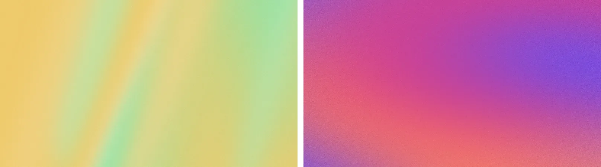

### `gridTitle`
Layers `bg`, `mesh`, `grid`, `grain` (+ `title`). The same field under a dotted grid of four cells each way.

Both were tuned against openai.com/news, measured rather than eyeballed: colour reaches every edge and corner (no page colour, no vignette), two or three hues in fields larger than the frame, directional sweeps and folds rather than round blobs, clear mid-tones (OKLCH lightness ~0.55–0.85, chroma ~0.1–0.2), and **no title on the image** (the page sets it under the card). Give a `title` and one sets lower left: the field is then toned so the palette's text clears 4.5:1 wherever the title sits (light pages: lightness 0.66–0.82; dark: 0.34–0.5), folds and streaks are left out, and a test checks every preset.


### `diagram`
Layers `bg`, `mesh`, `diagram`, `grain` (+ `title`). The field, toned a little deeper (lightness 0.4–0.6, so white lines clear 3:1, WCAG 1.4.11; tested on every preset), with white line-art and a dotted grid that breaks around it: the engineering-blog look. Options `icon`, `nodes`, `layout`, `arrows` (see the [`diagram` layer](#diagram)).

```js
await renderImage({ recipe: 'diagram', seed: post.id, layout: 'hub',
  nodes: [{ icon: 'lucide:globe' }, { icon: 'lucide:database' }, { icon: 'lucide:database' }, { icon: 'lucide:database' }] });
await renderImage({ recipe: 'diagram', seed: post.id, arrows: 'loop',
  nodes: [{ icon: 'lucide:send' }, { icon: 'lucide:settings' }, { icon: 'lucide:cpu' }] });
```


### `cutout`
Layers `bg`, `panel`, `shapes`, `icon` or `graph`, `grain` (+ `title`). A flat, matte field (the accent toned down: lightness 0.52–0.64, chroma 0.05–0.11), cut-paper shapes in off-white, and a hand-drawn icon or node graph. `panel: true` sets a hand-cut panel on the page colour instead of a full field. `shapes` (3; none on a panel), `graph`, `stroke: 'light' | 'dark'` (default: dark over paper, light on a bare field or panel; both clear 3:1 on the field). Muted palettes suit it: `{ accent: '#8b80c9' }` (lavender), `'#b5694f'` (clay), `'#8a9a7b'` (sage), `'#c4a052'` (ochre), `'#5f6f7f'` (slate).

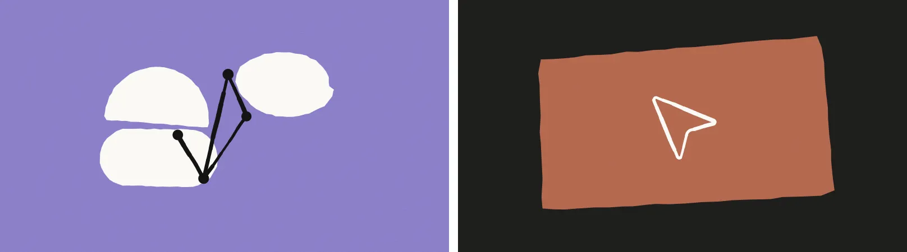

### `iconTile`
Layers `bg`, `glow`, `rings`, `icon`, `grain` (+ `title`). An icon on a raised tile over a soft tint of the accent, a glow and faint rings. With a title, the tile moves to the top left. `icon` is an Iconify name (a spark when none is given).

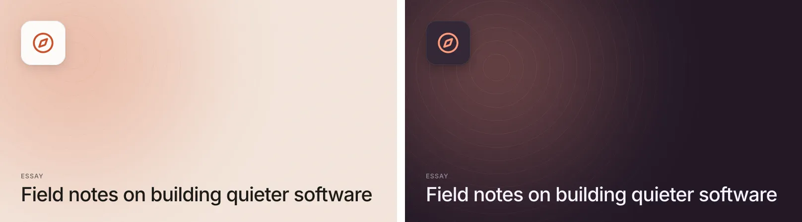

### `bigType`
Layers `bg`, `wash`, `grain`, `label`, `title`. The headline is the cover: large, tight (−0.045em), shrinking to fit four lines; the label in the accent at the top.

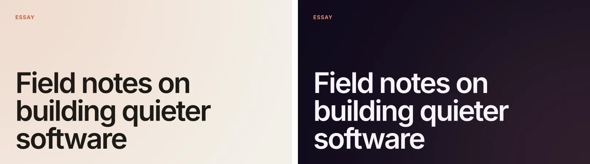

### `stripes`
Layers `bg`, `stripes`, `spot`, `icon`, `grain`, `title`. A tonal band of tapering stripes down one side (`side: 'left' | 'right'`), a disc riding its edge with an optional `icon`, and the title on the open side.

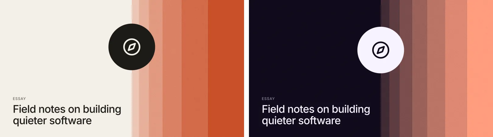

### `duotone`
Layers `image`, `scrim`, `grain`, `title`. A photo (`image`: a path or bytes) mapped to the palette's shadow and highlight colours, with a scrim under the title.

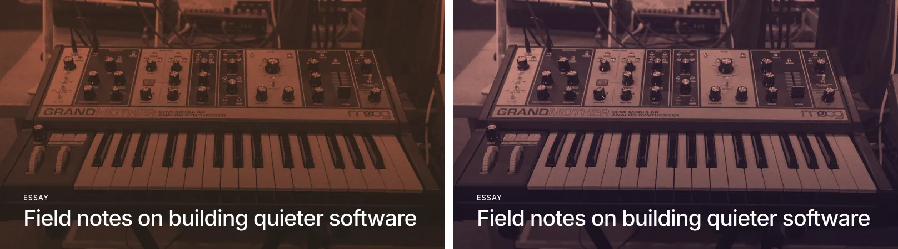

### `mark`
Layers `bg`, `icon`, `grain` (+ `title`). One icon, centred, on the accent, or on a gradient with `background: 'gradient'` (135°, the accent toward the palette's second colour, mixed in OKLCH so it stays vivid; `angle` and `colors` override). `icon` is an Iconify name or raw SVG (the spark by default); `size` is `'24vmin'`; grain is 0.03 (`grain: false` removes it). A title appears bottom left only when given.

`iconColor` is `'auto'` (default), `'white'`, `'black'` or a colour. Auto prefers **white** whenever white clears **3:1** (WCAG 1.4.11, non-text contrast; 4.5:1 is the rule for text) against everything under the icon: the fill, or for a gradient every colour across the icon's square (sampled along the gradient, not just its midpoint). Otherwise it's near-black. So a mid-tone orange-to-pink gradient keeps a white mark, and a yellow one gets a dark one. The title is text, so it keeps the icon's colour only where that clears 4.5:1 across the whole background.

```js
await renderImage({ recipe: 'mark', seed: 'podcast', icon: 'lucide:music', background: 'gradient' });
```

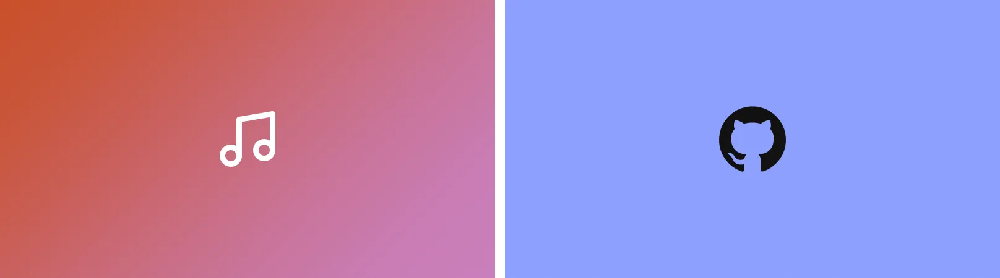

### `riso`
Layers `bg`, `inkA`, `inkB` (+ `inkC`, `title`). Two flat inks (three with `third: true`) overprinted on paper: big simple forms, misregistration, speckle or `texture: 'halftone'`, uneven density. `inks`: colours or classic inks (`['riso:pink', 'riso:blue']`); by default the palette's, toned to ink. On a dark palette the paper is the page colour and the inks print with `screen`.

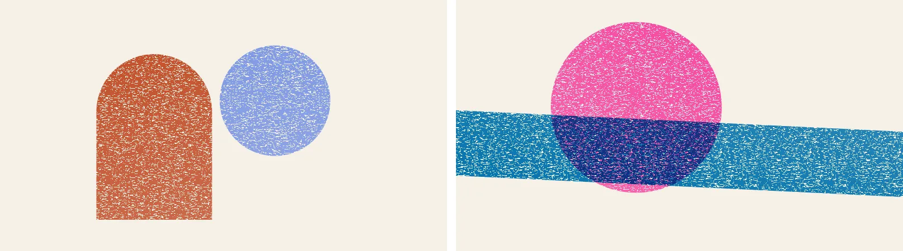

### `dither`
Layers `dither` (+ `title`). A noise field, gradient, or lit sphere / circle / arch, 1-bit. Options `matrix`, `cell`, `source`, `shape`, `three` (two dithered bands). A title sets on a solid block in the page colour. Encodes lossless by default (exact cells, ~1 KB; see Performance).

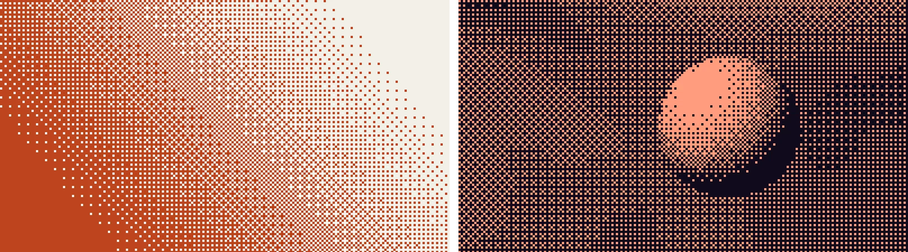

### `contour`
Layers `bg`, `contour`, `grain` (+ `title`). Isolines on a faintly tinted field, an index contour every fifth line, one line in the accent. `levels` (seeded 14–30 by default).

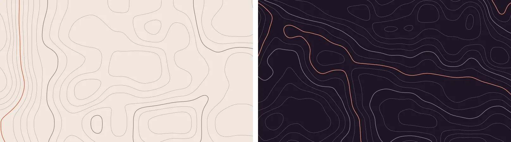

### `waveform`
Layers `bg`, `wave`, `grain` (+ `title`). `peaks` or `audio`, `style`, `field: 'flat' | 'toned'`, `duration` (seconds or text, shown under the wave). Bars clear 3:1 on the field; the title (top left) 4.5:1.

```js
await renderImage({ recipe: 'waveform', seed: episode.slug, audio: 'episodes/42.mp3', title: 'Episode 42', label: 'Podcast' });
```

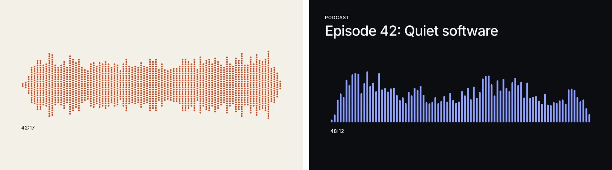

### `bauhaus`
Layers `bg`, `tiles` (+ `title` in a band below). `series` keeps a family's grid rhythm: `cover({ recipe: 'bauhaus', seed: post.id, series: 'autumn-2026' })`.

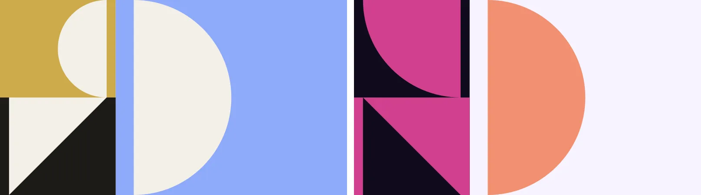

### `issue`
Layers `bg`, `masthead`, `date`, `rule`, `no`, `number` (+ `title`). A huge issue `number` in the accent (held to 3:1), set from the left, sized by its digit count to fill the width and cropped at the bottom only (at least 70% of it stays on the canvas on every aspect, tested); `masthead` and `date` above a hairline; "No." always above the numeral (`prefix: false` drops it). On wide canvases a title sits top right.

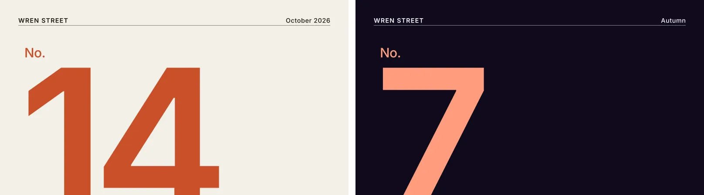

### `photo`
Layers `bg`, `mesh` or `photo`, `grain` (+ `title`). The palette of a photo (`image`) as full-bleed sweeps, the photo itself not shown; `show: 'blur'` shows it heavily blurred instead. Needs sharp. `extractPalette(image)` is exported on its own.

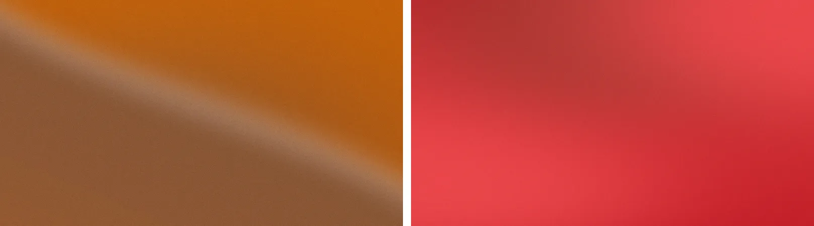

### `brand`
A brand on every format, the default for [`kit`](#brand-kit): avatars (the mark, or an initial), headers and banners (mark and name in the safe zone), posts and stories, business cards (front: mark and name; back: `person`, `role`, `lines`), letterhead and compliment slips, tickets (with a Code 128 `ticket` number), passes and stickers. Options: `name`, `tagline`, `mark`, `photo`, `lines`, `person`, `role`, `ticket`, `compliments`.

### Flyers (examples)
`examples/recipes/`: `bloomfall.json` (riso, two misregistered inks, halftoned cut-out), `grid-rest-rhythm.json` (Neo-Swiss grid, justified headline), `wheatpaste-torn.json` (torn sheet, knockout type, creases). `flyers/` holds ~45 more (aura, Neo-Swiss, acid, riso, kinetic, festival, varsity, ephemera, Bauhaus, 70s, lo-fi, zine), each with a release cover, and `release/` 16 cover-only styles. Each is drawn on a design grid in a `group`, so it renders at any `format`.

### Your own

```js
const poster = (o, { palette, rng, u }) => [
  { type: 'solid' },
  { type: 'shapes', count: rng.int(3, 6), kind: 'circle' },
  { type: 'text', content: o.title, size: u * 0.1, anchor: 'top-left' },
];
await renderSvg({ recipe: poster, seed: 'x', title: 'Hello' });
```

## Palettes

| Input | Means |
|---|---|
| `'dusk'` | A preset: `paper`, `ink`, `dawn`, `dusk`, `ocean`, `ember`, `moss`, `carbon`, `mono`. |
| `'#2563eb'` | One colour: an accent to derive a palette from. |
| `['#0c0d12', '#3d5afe', '#ff6b3d']` | `[bg, ...colors]`. |
| `{ bg, colors, text, accent, muted, surface }` | Any subset; the rest is derived. |

Resolved, a palette has `mode`, `bg`, `colors`, `text` (7:1 on `bg` when derived), `accent`, `onAccent` (white, or near-black when the accent is light), `muted` and `surface`.

From a theme's tokens:

```js
import { derivePalette } from '@arraypress/covers';

const palette = derivePalette({ accent: '#2563eb', bg: '#fdfdfd', text: '#1d1d1f' });
// or just: derivePalette({ accent: 'rgb(209 254 23)', mode: 'dark' })
```

The gradient colours are built in OKLCH around the accent's hue (the accent, two neighbours ±40° and a quiet complement), pastel on light backgrounds and deep on dark ones. Colours can be hex, `rgb()` or `hsl()`; alpha is ignored.

## JSON recipes

A cover style can be data: a JSON document, in a `.json` file or in a theme's config. The built-ins are written this way (`recipes/*.json`; read them for worked examples). Point `$schema` at the bundled schema for autocomplete and checking in your editor.

```json
{
  "$schema": "https://unpkg.com/@arraypress/covers/schema/recipe.schema.json",
  "name": "house",
  "params": { "background": "solid", "angle": 135 },
  "vars": {
    "ink": { "readable": "@accent" },
    "lean": { "range": [-8, 8] }
  },
  "layers": [
    { "id": "bg", "type": "solid", "color": "@accent", "when": { "background": "solid" } },
    { "id": "bg", "type": "linear", "when": { "background": "gradient" },
      "angle": { "add": ["{angle}", "$lean"] },
      "colors": ["@accent", { "mix": ["@accent", "@colors.1", 0.5, "oklch"] }] },
    { "id": "grid", "type": "pattern", "kind": "grid", "color": "$ink", "fade": "edges",
      "opacity": { "if": { "mode": "dark" }, "then": 0.16, "else": 0.12 } },
    { "id": "grain", "type": "grain", "amount": 0.05 },
    { "id": "title", "type": "text", "when": "title", "content": "{title}", "label": "{label}",
      "color": "$ink", "size": { "mul": ["@u", 0.066] }, "maxLines": 3 }
  ]
}
```

```js
import { loadRecipe, renderImage } from '@arraypress/covers';

const house = loadRecipe('./src/covers/house.json'); // or defineRecipe(json), or pass the object as `recipe`
await renderImage({ recipe: house, seed: 'my-post', title: 'Hello', background: 'gradient' });
```

A layer is any [layer](#layers) plus an optional `id` and `when`. Its option values can be literals or:

| Form | Means |
|---|---|
| `"@bg"`, `"@text"`, `"@accent"`, `"@onAccent"`, `"@muted"`, `"@surface"`, `"@mode"`, `"@colors"`, `"@colors.N"` | The palette (`colors.N` wraps around). |
| `"@width"`, `"@height"`, `"@u"` | The canvas in px (`u` = `sqrt(width × height)`, the unit the built-ins size type with). |
| `"@safeX"`, `"@safeY"`, `"@safeWidth"`, `"@safeHeight"` | The safe box: a format's safe zone, a print piece's trim less its safe margin, else the canvas. |
| `"@bleed"`, `"@safe"`, `"@trimWidth"`, `"@trimHeight"`, `"@mm"`, `"@dpi"` | Print set-up, px (undefined off print formats). |
| `"{name}"`, `"{mark}"`, `"{photo}"`, `"{cutout}"`, `"{lines}"`, `"{lineup}"`, `"{dates}"`, `"{tracklist}"`, `"{venue}"`, `"{address}"`, `"{date}"`, `"{time}"`, `"{price}"`, `"{meta}"` | Brand and event data, readable without declaring them. `"{lineup.0}"`, `"{meta.venue}"` reach into lists and objects. |
| `{ "join": [list, sep] }`, `{ "upper": s }`, `{ "lower": s }`, `{ "slice": [v, start, end] }` | Lists and strings. |
| `{ "keyframes": [[t, value], …], "ease": "inOut", "loop": true }` | An animated value (see [Animation](#animation)). |
| `"$name"`, `"$name.0"`, `"$name.x"` | A var (or an item or field of it). |
| `"{layout.title.bottom}"`, `"{layout.title.bottom + 12}"` | Where an earlier text layer's block landed, filled in when drawn. |
| `"{#col * 42 + 8}"` | Inside a `repeat`: an expression over the instance, filled in when drawn. |
| `"{title}"`, `"{label}"`, `"{icon}"`, `"{image}"`, `"{param}"`, `"{opt.anything}"` | A cover option. A whole-string token keeps the value's type (a number stays a number, a label object stays an object); inside longer text it's interpolated (`"Read {title}"`). An unset option drops the key. |
| `{ "mix": [a, b, t] }`, `{ "mix": [a, b, t, "oklch"] }` | Two colours mixed in OKLab, or in OKLCH (hue the short way, so far-apart hues stay vivid). |
| `{ "readable": c }`, `{ "readable": [c, light, dark] }` | White (or `light`), or near-black (or `dark`), whichever reads better on `c`. |
| `{ "readable": [backgrounds, ratio, prefer] }` | `prefer` (`"white"`, `"black"` or a colour) when it clears `ratio` on every background (one colour or a list), else the better of white and near-black. `[c, 3, "white"]` is the icon rule. |
| `{ "tone": [color, { l: [min, max], c: [min, max] }] }` | The colour pulled into an OKLCH band, its hue kept. |
| `{ "gradientUnder": [colors, angle, size] }` | The colours a centred square of `size` covers in a linear gradient (five samples, eased as drawn). Pair it with `readable`. |
| `{ "pick": [...] }`, `{ "range": [min, max] }`, `{ "int": [min, max] }` | Seeded choices. |
| `{ "add" / "sub" / "mul" / "div" / "min" / "max": [...] }` | Arithmetic. Lengths (`"54vw"`, `"12vmin"`) become px first. |
| `{ "ramp": [from, to, steps, amount?] }` | `steps` colours from `from` toward `to` (`amount` of the way). |
| `{ "taper": [ratio, steps] }` | `[1, ratio, ratio², …]`, e.g. stripe widths. |
| `{ "length": value }` | Characters in a string (a number's digits) or items in an array. |
| `{ "reverse": array }` | |
| `{ "if": condition, "then": a, "else": b }` | A choice. Only the chosen side is evaluated (and draws from the stream). |
| `"@@x"`, `"$$x"` | A literal `@x` / `$x`. |

Conditions (a layer's `when`, an `if`): `"title"` (the option is set; an override object counts when it has `content`, `name`, `svg` or `src`), `{ "background": "gradient" }` (equals; an array means any of; `mode` is the palette's, `aspect` the canvas's: `'wide'`, `'square'` or `'tall'`, `format` the format's name, `page` the page being drawn), `{ "not": c }`, `{ "all": [...] }`, `{ "any": [...] }`.

Layers nest (`group.layers`, `knockout`, `clip`, `mask`) and are validated the same way, `when` included. An `svg` layer's `markup` and `defs` are left alone except for `{{name}}` slots, which are filled from the options (escaped) and vars (`{{$name}}`); `{{@accent}}`, `{{id}}` and `{{seed}}` are filled when it's drawn.

- **`params`** are the options a recipe reads, with defaults; a cover option of the same name overrides one. `title`, `label`, `icon` and `image` are always available. **`requires`** lists options that must be set (`["image"]`).
- **`vars`** are resolved once, in order, before the layers; their draws use the cover's recipe stream. Draws inside a layer use that layer's own stream, so adding a layer never changes another's choices.
- **`output`** (`{ "lossless": true }`) sets the encoding the style prefers in `renderImage`.
- **`pages`** (`["front", "back"]`) makes the style two-sided (see [Two-sided pages](#two-sided-pages)).
- **`fonts`** (`[{ "name": "Fraunces", "src": "fonts/Fraunces.woff2", "weight": [100, 900] }]`) declares the faces the style uses: a path beside the recipe file, or a URL. Callers don't register them.
- **Overrides by id** work exactly as for the built-ins (`grain: false`, `mesh: { blur: 30 }`), and so do extra `layers`.
- **Validation** runs when the recipe is defined, and stops at the first problem with the recipe's name, the JSON path and what to do: `Recipe "house": layers[2] (grid).blurr: "pattern" layers have no option "blurr" (kind, size, …)`, `unknown token "@bgg"`, `unknown param "subtitle" (declare it in "params", or use "{opt.subtitle}")`.
- The schema is exported as `@arraypress/covers/recipe.schema.json`, and the built-ins as `@arraypress/covers/recipes/<name>.json` to copy and edit.

All seventeen built-ins are JSON, with no JS fallback. The tests check that six of them render byte-identical SVG to JavaScript versions kept as a fixture, across palettes, aspects and options, object overrides included (the other ten were written as JSON from the start).

## Astro

```ts
// src/pages/covers/[slug].webp.ts
import { getCollection } from 'astro:content';
import { coverEndpoint } from '@arraypress/covers/astro';

export const { getStaticPaths, GET } = coverEndpoint({
  getEntries: () => getCollection('posts'),
  cover: (post) => ({ recipe: 'gridTitle', seed: post.id, title: post.data.title, aspect: '16:9' }),
});
```

`astro build` writes `dist/covers/<id>.webp` for every post; `astro dev` renders on request. Link to one with `coverUrl(post.id)` (→ `/covers/<id>.webp`).

A theme can keep its cover style in its config as JSON and pass it straight through:

```ts
// src/config/site.ts
export const siteConfig = {
  covers: {
    palette: { accent: '#2563eb', bg: '#fdfdfd', text: '#1d1d1f' },
    recipe: {
      name: 'journal',
      params: { background: 'gradient' },
      layers: [
        { id: 'bg', type: 'linear', angle: 135, colors: ['@accent', { mix: ['@accent', '@colors.1', 0.5, 'oklch'] }] },
        { id: 'grain', type: 'grain', amount: 0.05 },
        { id: 'title', type: 'text', when: 'title', content: '{title}', color: '@onAccent', size: { mul: ['@u', 0.07] } },
      ],
    },
  },
};

// src/pages/covers/[slug].webp.ts
import { getCollection } from 'astro:content';
import { coverEndpoint } from '@arraypress/covers/astro';
import { derivePalette } from '@arraypress/covers';
import { siteConfig } from '../../config/site';

const palette = derivePalette(siteConfig.covers.palette);
export const { getStaticPaths, GET } = coverEndpoint({
  getEntries: () => getCollection('posts'),
  cover: (post) => ({ recipe: siteConfig.covers.recipe, seed: post.id, title: post.data.title, palette }),
});
```

Or keep it in a file: `recipe: loadRecipe('./src/covers/journal.json')`.

| Option | Default | |
|---|---|---|
| `getEntries` | — | The entries. |
| `cover` | — | An entry's cover options (may be async). |
| `slug` | `entry.id ?? entry.slug` | |
| `param` | `'slug'` | The route param, matching the file name. |
| `format` | `'webp'` | Match the file's extension (`[slug].png.ts` → `'png'`). |
| `quality` | per format | |
| `cache` | `true` | See below. |

Notes:

- Entries with nested ids (`blog/2026/post`) need a rest route: `[...slug].webp.ts`.
- In `output: 'server'`, add `export const prerender = true;` to keep the covers static. On-demand routes also work (the entry is looked up by slug).
- `coverUrl(slug, { base, format })` encodes each path segment.

## Caching

`renderImage(cover, { cache: true })` (the Astro helper's default) stores renders in `node_modules/.cache/covers`, keyed by a SHA-256 of the resolved cover: size, seed, palette, every layer option, font and image bytes (hashed by content), the format, quality and this package's version. An unchanged cover is read back instead of drawn; change anything and it renders again. Pass a directory instead of `true` to put the cache elsewhere (e.g. one your CI restores between builds).

## Performance

Measured on an Apple M3 Max, Node 26, 1200×1200 WebP at the default quality (median of 5):

| Recipe | `renderSvg` | `renderImage` | Size |
|---|---|---|---|
| aurora | <1 ms | 154 ms | 245 KB |
| gridTitle | <1 ms | 139 ms | 196 KB |
| iconTile | 2 ms | 103 ms | 37 KB |
| bigType | 1 ms | 79 ms | 32 KB |
| stripes | 1 ms | 84 ms | 69 KB |
| duotone | 21 ms | 204 ms | 159 KB |
| mark | 1 ms | 73 ms | 38 KB |
| diagram | <1 ms | 113 ms | 110 KB |
| cutout | 1 ms | 71 ms | 37 KB |
| riso | 29 ms | 171 ms | 311 KB |
| dither | 3 ms | 70 ms | 156 KB |
| contour | 11 ms | 120 ms | 117 KB |
| waveform | 1 ms | 68 ms | 24 KB |
| bauhaus | <1 ms | 44 ms | 12 KB |
| issue | 1 ms | 43 ms | 16 KB |
| photo | <1 ms | 124 ms | 147 KB |

(The gradient fields and riso are the heaviest files: saturated colour or speckle plus grain at WebP 90. See "Grain versus file size" below.)

A 1200×630 `og` card is about 70 ms. The first render in a process adds ~80 ms (HarfBuzz's WebAssembly and the fonts load once). Cached covers cost a file read.

How it rasterises, and why:

- **Blur** is SVG `feGaussianBlur`, through sharp's librsvg. librsvg clips a filter's input to the canvas, so a blur near an edge pulls in transparency and the field fades there (a vignette). `renderImage` renders each `mesh` layer on its own canvas padded by 3σ, at the smallest scale its finest blur allows (blur this heavy has no detail to lose), then crops and upscales it: full-bleed, and cheaper than the unpadded render. Browsers draw the plain SVG's filters without that clip.
- **Textures are image tiles.** The riso speckle and halftone are small PNG tiles in an SVG `<pattern>`, and dithers are one PNG pixel per cell scaled with `image-rendering: pixelated` (a minimal in-library PNG encoder, so no sharp needed for SVG). Two librsvg slow paths are avoided on purpose: a pattern of one shape per cell (~1.5 s a canvas) and a mask under a transform (~10×), which is why misregistration moves the shapes, not the texture.
- **Grain** is not. librsvg's `feTurbulence` costs ~200 ms at that size, so `renderImage` splits the stack at each grain layer: the layers below are rasterised, seeded noise (a triangular distribution, closer to film than flat noise) is blended in JS with the W3C formulas (~10 ms; sharp's own overlay blend flattens partly transparent noise to almost nothing), and the layers above are composited on top. `renderSvg` keeps `feTurbulence`, which browsers draw quickly; the two grains are matched in strength.
- **Filters at release size.** libvips hands librsvg large documents in a way that makes filter-heavy SVGs slow far past their pixel count (a 3000² displacement map: ~28 s in one piece, ~5 s as tiles), so `renderImage` draws an SVG with filters past ~2.4 MP as 1024 px tiles in parallel, each with a margin round it so blurs and displacements see across the seam. It also splits `feMorphology` into an x pass and a y pass (the same max, O(r) not O(r²)), and shrinks a filter's region to the box the layer paints when the chain can't paint outside its source (worked out from the primitives). Dithers are computed on pixels. Together these took the slowest release covers from minutes to seconds (see the CHANGELOG).
- **Pixel effects** (spin, zoom, bokeh, distortions…) draw the layer once at its output pixels and work on typed arrays: polar resampling with running sums for spin and zoom (a long blur costs no more than a short one), an aperture convolved a row at a time from running totals for bokeh, and wide blurs on smaller copies. A full 3000² `renderImage` of a photo with any one effect takes 0.4–2.8 s (median 0.8 s; the photo alone 0.4 s); the slowest are `newsprint`, `motion` and `halftone`.
- **Text** is shaped by HarfBuzz (`harfbuzzjs`, a 440 KB WebAssembly build) and written as path data. opentype.js was tried first and dropped: Inter's kerning lives in GPOS extension lookups that neither its 1.x nor 2.x reads, and 2.0 throws on Inter's contextual substitutions.

**Grain versus file size.** Grain is the first thing a lossy encoder throws away. On a cover with grain, WebP quality 82 keeps about 40% of it, 90 about 60%, 94 about 78%, and the file grows each step (a dark aurora: 26 KB at 80, 60 KB at 85, 144 KB at 90; 19 KB at 90 without grain). **The default stays at WebP 90** (72 AVIF, 88 JPEG): the owner compared 80 and 90 on the gallery and 80 visibly loses the grain and starts to band the gradients. For a grid of small thumbnails, pass `quality: 80` or `grain: false` knowingly; for crisp grain, raise it or use PNG.

**Lossless where it wins.** A recipe can declare the encoding it prefers (`"output": { "lossless": true }` in its JSON; `renderImage` options still win). `dither` does: it's flat 1-bit art, so lossless WebP is both exact and tiny, while lossy WebP smears the cells. Measured at 1200×1200:

| Recipe | PNG | WebP lossless | WebP q90 | WebP q80 |
|---|---|---|---|---|
| dither (3 palettes) | 42–45 KB | **~1 KB**, exact | 153–240 KB, 3–5% of pixels wrong | 125–196 KB, 3.5–5% wrong |
| contour (3 palettes) | 808–1074 KB | 511–661 KB | **145–183 KB**, visually exact | 101–135 KB |

Contour carries grain, so it stays lossy like the rest. Pass `lossless: true` to `renderImage` for any cover.

## Tests

`npm test` runs the suite, including:

- **Byte identity with 1.0**: 694 covers (every built-in recipe across palettes, aspects and options, and every 1.0 layer on its own), hashed with the 1.0.0 code before any 1.1 change, must render the same SVG.
- **Image filters**: numeric properties per effect (spin and zoom keep the centre pixel, threshold draws two colours, a lens turns a point into a disc of its radius, pixel sort keeps every pixel of a row, a turned motion blur is directional, masks leave the layer exact where they're 0), seeds, validation and the Worker fallback; `COVERS_SLOW=1` renders every effect at 3000².
- **A browser smoke test** in headless Chrome over the DevTools protocol (`COVERS_CDP`, default `http://localhost:9334`; skipped without one): vector and text covers draw the same bytes as Node, the pixel layers render, `renderBlob` encodes PNG and WebP, and HarfBuzz loads its wasm from a URL.

`npm run test:worker` runs covers inside workerd with `wrangler dev` (needs wrangler).

## Gallery

```bash
npm run gallery
```

renders every recipe × 3 seeds × 2 palettes × 2 aspects into `examples/out/`, with an `index.html` to look through and a contact sheet per recipe. `node examples/docs-images.mjs` rebuilds the images in this README.

## Licence

MIT © ArrayPress Limited. Inter is © The Inter Project Authors, SIL Open Font License 1.1 (`fonts/OFL.txt`). The example photo is from Unsplash (`examples/CREDITS.md`) and isn't published with the package.
