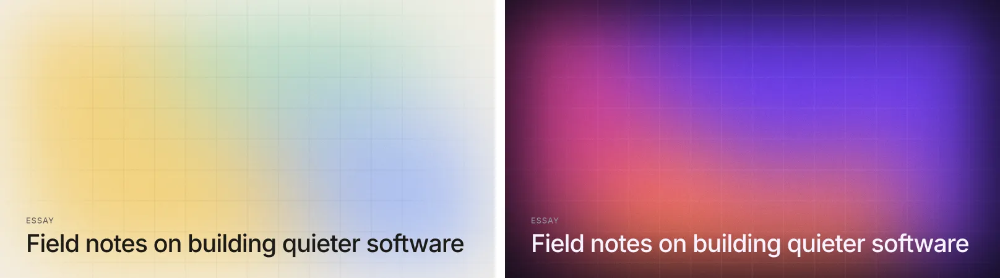
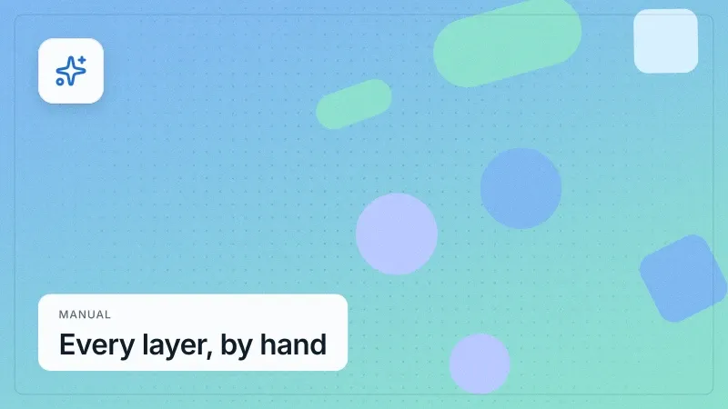

# covers docs

Cover images, flyers, posters, release art, social formats and print stationery: soft mesh gradients, film grain, riso inks and halftones, knockout and justified type, torn paper, barcodes and more, drawn from one **seed** and a stack of layers. The same slug always gives the same image, and two posts never look alike.

Seventeen recipes cover the editorial looks and a brand kit (full-bleed gradient fields, engineering-blog line diagrams, cut-paper collages, risograph prints, 1-bit dithers, topographic contours, podcast waveforms, Bauhaus grids, magazine issue numbers, palettes from photos, stripe bands, an icon tile, big type, duotone photos, a single-icon mark), and every layer under them is yours to change, remove or add to. Recipes are data: the built-ins are JSON documents, and a theme can write its own cover style the same way, with no JavaScript (see [JSON recipes](json-recipes.md)). Output is an SVG string (text as outlines, so it needs no fonts) or WebP / PNG / AVIF / JPEG via [sharp](https://sharp.pixelplumbing.com). Inter ships in the package, so it works with no setup. There's an Astro helper that turns a content collection into static covers in three lines.

No telemetry, no DOM required. It runs in Node at build time, in a browser, and in a Cloudflare Worker (see [Running anywhere](platforms.md)); in Node it never touches the network unless you ask.



## Contents

- [API](api.md): every export, the cover options, lengths
- [Layers](layers.md): every layer type and its options, poster type and poster layers
- [Effects](effects.md): effects on layers, masks, paints
- [Recipes](recipes.md): the seventeen built-ins, the flyers and release covers, your own
- [JSON recipes](json-recipes.md): a cover style as data, tokens and conditions
- [Palettes](palettes.md): presets, one accent, a theme's tokens
- [Formats, print and brand kits](formats.md): named sizes and safe zones, print, `kit`, `lint`
- [Animation](animation.md): motion in the SVG, keyframes
- [Running anywhere](platforms.md): Node, browsers, Cloudflare Workers, `configure`
- [Astro](astro.md): `coverEndpoint` for a content collection
- [Caching and performance](performance.md): the cache, timings, grain versus file size
- [Tests and gallery](development.md)

## Build the stack yourself

Without a recipe, a cover is the layers you give it:

```js
const svg = await renderSvg({
  seed: 'hello',
  palette: ['#0c0d12', '#3d5afe', '#ff6b3d', '#9b4dff'], // [bg, ...colors]
  layers: [
    { type: 'mesh', blur: '12vmax' },
    { type: 'pattern', kind: 'grid', fade: 'edges' },
    { type: 'grain', amount: 0.08 },
    { type: 'text', content: 'Hello', anchor: 'bottom-left', size: 96 },
  ],
});
```


