# Recipes

A recipe returns a stack of layers with ids. Customise any of them by id:

- a **string** is the layer's content: `title: 'Hello'`, `icon: 'lucide:feather'`
- an **object** is merged into the layer: `mesh: { blur: '16vmax' }`, `title: { content: 'Hello', size: 96 }`
- **`false`** removes it: `grain: false`

```js
await renderImage({
  recipe: 'gridTitle',
  seed: post.slug,
  title: post.title,
  mesh: { hues: 2, blur: '14vmax' },
  grid: { kind: 'dots' },
  layers: [{ type: 'frame' }], // painted on top
});
```

Every recipe takes an optional `title` and `label`.

## `aurora`
Layers `bg`, `mesh`, `grain` (+ `title`). Full-bleed sweeps of the palette's colours; per seed, sometimes a silk fold, sometimes motion streaks, sometimes grain heavier at the edges.

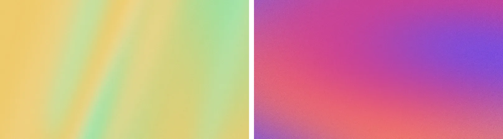

## `gridTitle`
Layers `bg`, `mesh`, `grid`, `grain` (+ `title`). The same field under a dotted grid of four cells each way.

Both were tuned against openai.com/news, measured rather than eyeballed: colour reaches every edge and corner (no page colour, no vignette), two or three hues in fields larger than the frame, directional sweeps and folds rather than round blobs, clear mid-tones (OKLCH lightness ~0.55–0.85, chroma ~0.1–0.2), and **no title on the image** (the page sets it under the card). Give a `title` and one sets lower left: the field is then toned so the palette's text clears 4.5:1 wherever the title sits (light pages: lightness 0.66–0.82; dark: 0.34–0.5), folds and streaks are left out, and a test checks every preset.

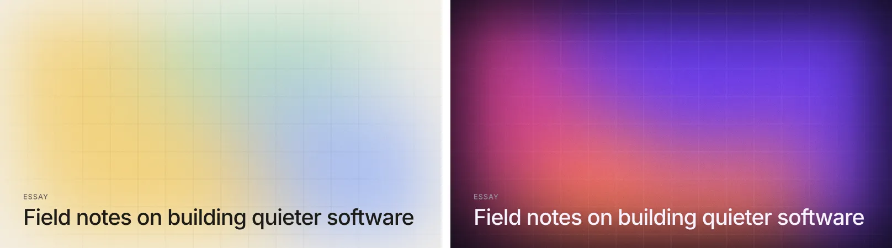

## `diagram`
Layers `bg`, `mesh`, `diagram`, `grain` (+ `title`). The field, toned a little deeper (lightness 0.4–0.6, so white lines clear 3:1, WCAG 1.4.11; tested on every preset), with white line-art and a dotted grid that breaks around it: the engineering-blog look. Options `icon`, `nodes`, `layout`, `arrows` (see the [`diagram` layer](layers.md#diagram)).

```js
await renderImage({ recipe: 'diagram', seed: post.id, layout: 'hub',
  nodes: [{ icon: 'lucide:globe' }, { icon: 'lucide:database' }, { icon: 'lucide:database' }, { icon: 'lucide:database' }] });
await renderImage({ recipe: 'diagram', seed: post.id, arrows: 'loop',
  nodes: [{ icon: 'lucide:send' }, { icon: 'lucide:settings' }, { icon: 'lucide:cpu' }] });
```


## `cutout`
Layers `bg`, `panel`, `shapes`, `icon` or `graph`, `grain` (+ `title`). A flat, matte field (the accent toned down: lightness 0.52–0.64, chroma 0.05–0.11), cut-paper shapes in off-white, and a hand-drawn icon or node graph. `panel: true` sets a hand-cut panel on the page colour instead of a full field. `shapes` (3; none on a panel), `graph`, `stroke: 'light' | 'dark'` (default: dark over paper, light on a bare field or panel; both clear 3:1 on the field). Muted palettes suit it: `{ accent: '#8b80c9' }` (lavender), `'#b5694f'` (clay), `'#8a9a7b'` (sage), `'#c4a052'` (ochre), `'#5f6f7f'` (slate).

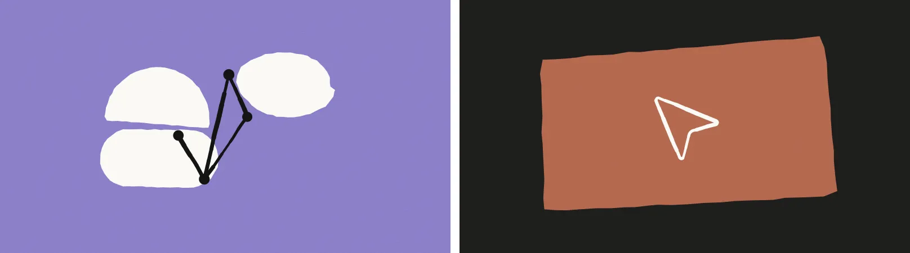

## `iconTile`
Layers `bg`, `glow`, `rings`, `icon`, `grain` (+ `title`). An icon on a raised tile over a soft tint of the accent, a glow and faint rings. With a title, the tile moves to the top left. `icon` is an Iconify name (a spark when none is given).

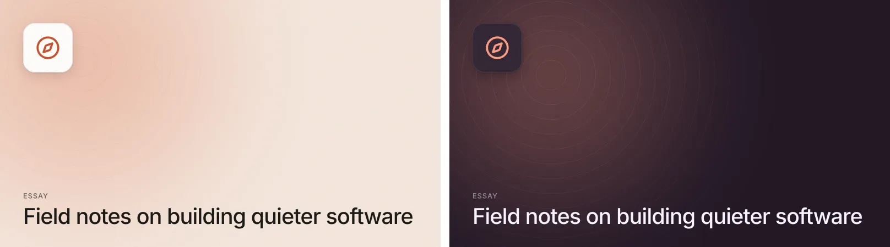

## `bigType`
Layers `bg`, `wash`, `grain`, `label`, `title`. The headline is the cover: large, tight (−0.045em), shrinking to fit four lines; the label in the accent at the top.

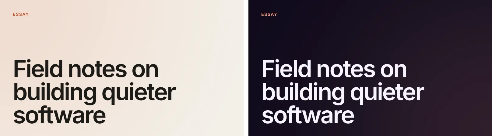

## `stripes`
Layers `bg`, `stripes`, `spot`, `icon`, `grain`, `title`. A tonal band of tapering stripes down one side (`side: 'left' | 'right'`), a disc riding its edge with an optional `icon`, and the title on the open side.

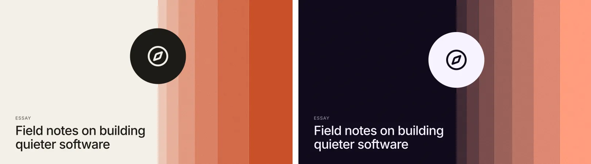

## `duotone`
Layers `image`, `scrim`, `grain`, `title`. A photo (`image`: a path or bytes) mapped to the palette's shadow and highlight colours, with a scrim under the title.

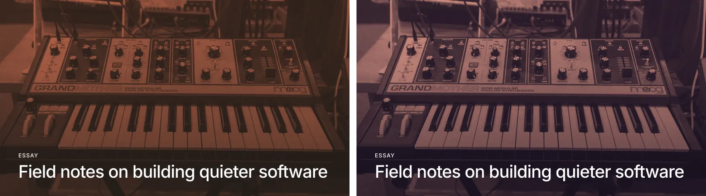

## `mark`
Layers `bg`, `icon`, `grain` (+ `title`). One icon, centred, on the accent, or on a gradient with `background: 'gradient'` (135°, the accent toward the palette's second colour, mixed in OKLCH so it stays vivid; `angle` and `colors` override). `icon` is an Iconify name or raw SVG (the spark by default); `size` is `'24vmin'`; grain is 0.03 (`grain: false` removes it). A title appears bottom left only when given.

`iconColor` is `'auto'` (default), `'white'`, `'black'` or a colour. Auto prefers **white** whenever white clears **3:1** (WCAG 1.4.11, non-text contrast; 4.5:1 is the rule for text) against everything under the icon: the fill, or for a gradient every colour across the icon's square (sampled along the gradient, not just its midpoint). Otherwise it's near-black. So a mid-tone orange-to-pink gradient keeps a white mark, and a yellow one gets a dark one. The title is text, so it keeps the icon's colour only where that clears 4.5:1 across the whole background.

```js
await renderImage({ recipe: 'mark', seed: 'podcast', icon: 'lucide:music', background: 'gradient' });
```

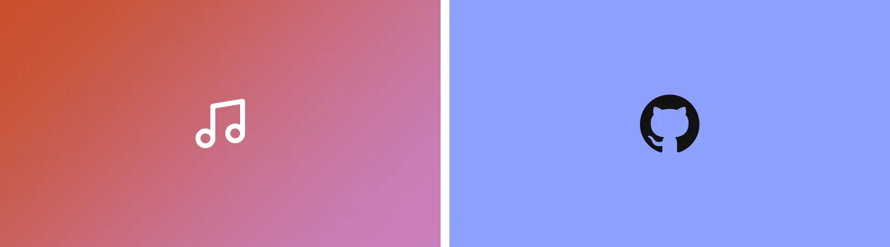

## `riso`
Layers `bg`, `inkA`, `inkB` (+ `inkC`, `title`). Two flat inks (three with `third: true`) overprinted on paper: big simple forms, misregistration, speckle or `texture: 'halftone'`, uneven density. `inks`: colours or classic inks (`['riso:pink', 'riso:blue']`); by default the palette's, toned to ink. On a dark palette the paper is the page colour and the inks print with `screen`.

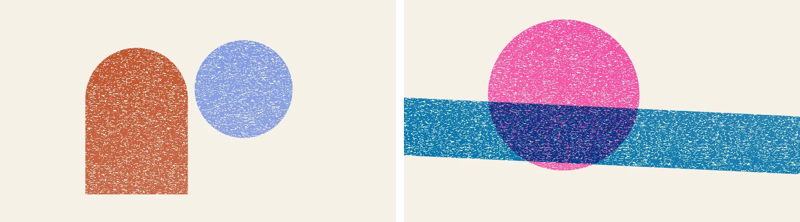

## `dither`
Layers `dither` (+ `title`). A noise field, gradient, or lit sphere / circle / arch, 1-bit. Options `matrix`, `cell`, `source`, `shape`, `three` (two dithered bands). A title sets on a solid block in the page colour. Encodes lossless by default (exact cells, ~1 KB; see [Performance](performance.md#performance)).

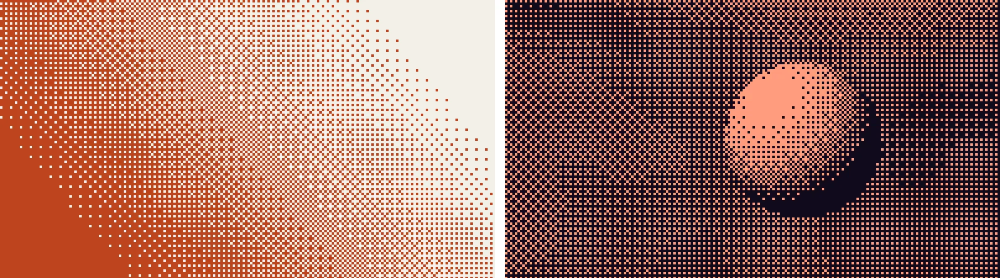

## `contour`
Layers `bg`, `contour`, `grain` (+ `title`). Isolines on a faintly tinted field, an index contour every fifth line, one line in the accent. `levels` (seeded 14–30 by default).

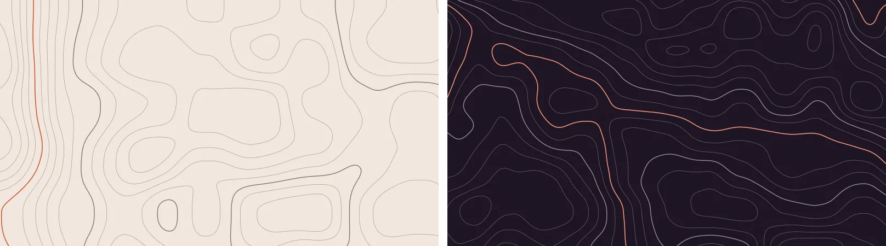

## `waveform`
Layers `bg`, `wave`, `grain` (+ `title`). `peaks` or `audio`, `style`, `field: 'flat' | 'toned'`, `duration` (seconds or text, shown under the wave). Bars clear 3:1 on the field; the title (top left) 4.5:1.

```js
await renderImage({ recipe: 'waveform', seed: episode.slug, audio: 'episodes/42.mp3', title: 'Episode 42', label: 'Podcast' });
```

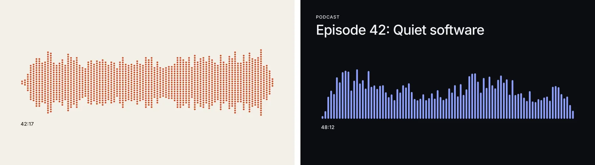

## `bauhaus`
Layers `bg`, `tiles` (+ `title` in a band below). `series` keeps a family's grid rhythm: `cover({ recipe: 'bauhaus', seed: post.id, series: 'autumn-2026' })`.

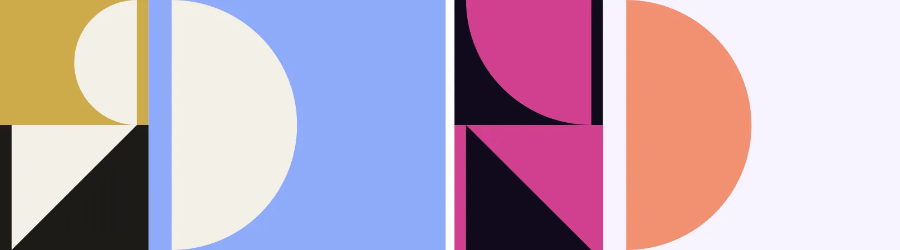

## `issue`
Layers `bg`, `masthead`, `date`, `rule`, `no`, `number` (+ `title`). A huge issue `number` in the accent (held to 3:1), set from the left, sized by its digit count to fill the width and cropped at the bottom only (at least 70% of it stays on the canvas on every aspect, tested); `masthead` and `date` above a hairline; "No." always above the numeral (`prefix: false` drops it). On wide canvases a title sits top right.

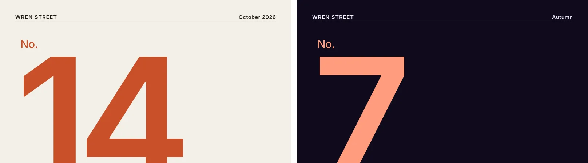

## `photo`
Layers `bg`, `mesh` or `photo`, `grain` (+ `title`). The palette of a photo (`image`) as full-bleed sweeps, the photo itself not shown; `show: 'blur'` shows it heavily blurred instead. Needs sharp. `extractPalette(image)` is exported on its own.

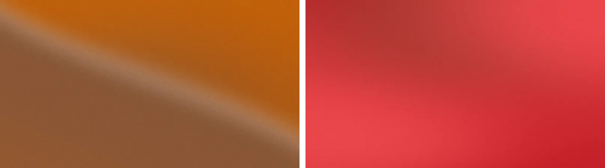

## `brand`
A brand on every format, the default for [`kit`](formats.md#brand-kit): avatars (the mark, or an initial), headers and banners (mark and name in the safe zone), posts and stories, business cards (front: mark and name; back: `person`, `role`, `lines`), letterhead and compliment slips, tickets (with a Code 128 `ticket` number), passes and stickers. Options: `name`, `tagline`, `mark`, `photo`, `lines`, `person`, `role`, `ticket`, `compliments`.

## Flyers and release covers
The package ships 92 more recipes beside the built-ins, each drawn on a design grid in a `group` so it renders at any `format`: `recipes/flyers/` (60 flyers: aura, Neo-Swiss, acid, riso, kinetic, festival, varsity, ephemera, Bauhaus, 70s, lo-fi, zine, wheatpaste, and eight `-motion` ones that move; each re-composes for a 3000×3000 cover with `format: 'release'`; eight more draw on a grid as tall as the canvas, so they set at 4:5, 1:1, 9:16 or A4 alike: `grid-poster`, `logofolio`, `pixel-mosaic`, `construction`, `fluted-poster`, `series-card`, `dissolve-poster` and `terminal-poster`, below), `recipes/release/` (20 cover-only styles) and `recipes/release/series/` (12 more for a series). Import one as JSON, or load it by path:

```js
import bloomfall from '@arraypress/covers/recipes/flyers/bloomfall.json' with { type: 'json' };
const svg = await renderSvg({ recipe: defineRecipe(bloomfall), seed: 'gig', mark, photo, cutout });
// or by path (Node): loadRecipe(new URL(import.meta.resolve('@arraypress/covers/recipes/release/swiss.json')))
```

They fill slots from the options (`{name}`, `{mark}`, `{photo}`, `{cutout}`…; each file's `params` has defaults), and their `$schema` points at the bundled schema.

| Flyer | Options (beside `mark`, `photo`, `name`) |
|---|---|
| `grid-poster` | A Swiss grid poster: the photo washed in one colour (or a grainy field in it), a hairline 5-column grid whose rows follow the aspect (8 at 4:5, 6 at 1:1, 11 at 9:16), meta in its cells, the mark on a tile in one cell, a two-weight headline fitted to four columns. `headline` (lines: strings or `{ content, bold }`), `sub`, `series`, `handle`, `year`, `label`, `code`, `coords`, `credit`, `save`, `wash`, `ink`, `tile`, `markColor`. |
| `logofolio` | A collection sheet: a title, a sub-title and meta line, and `marks` (paths) on an even grid, optically sized the same; `cols` and `rows` from the count (3 × 3 to 10 × 7). `title`, `subtitle`, `meta`, `footer`, `ground`, `ink`. |
| `pixel-mosaic` | A greyscale photo (or grainy field) under the mark rastered into big cells in one neon ink (`@logomarks/core`'s pixelate), a few left out by seed, an accent in one cell, the name huge across the foot and a meta row. `neon`, `ink`, `cells` (8–14), `drop`, `accent` (`'asterisk'`, `'dot'`, `false`), `badge` (`'®'` or `'mark'`), `labels`, `volume`. |
| `construction` | A construction sheet: the mark over its own construction, read from its paths (a dashed square grid, its box, a centre cross, the inscribed and circumscribed circles, the circles its curves are drawn on and the lines its straight edges lie on) in one thin accent, and meta in the corners. `name`, `meta`, `gridLabel` (default `Grid 8 × 8`), `caption` (`®`), `grid`, `size`, `ground`, `ink`, `accent` (`#3b82f6`). |
| `fluted-poster` | A subject in white on black behind fluted glass (`@logomarks/image-effects`' `fluted`, rastered and embedded): the mark, the name's initial set huge (filling the height between the year and the title), or the whole name; a soft light in the accent behind it, and vector Swiss type over it: the year stacked, the series, a two-line title with a glitched `\|\|` of bars, credits and an edition line. `subject` (`'mark'`, `'name'`: the initial, `'word'`: the whole name), `initial` (one or two characters; default the name's first letter), `preset` (`fluted` by default; `reeded-deep`, `reeded-prism`, `reeded-soft`), `title`, `year`, `series`, `credits`, `edition`, `accent` (`''` for none), `ground`, `ink`. |
| `series-card` | A numbered card for a run of posts: a flat soft colour, a two-line uppercase title, a large number, and the mark solid or as contour lines (its outline and more round it). `title`, `number`, `label`, `style` (`'contour'`, `'solid'`), `lines` (3–5), `gap`, `ground`, `ink`. |
| `dissolve-poster` | One flat strong ground (red by default), the subject in the ink (a `cutout` or `photo` portrait, its tones mapped from the ink to the ground, or the mark large) dissolving into the ground through a growing diamond dot screen (`@logomarks/image-effects`' `halftoneFade`), a few strays above; Swiss corner type and an optional big `title` the dots never touch (with a title, they merge just above it). `ground`, `ink`, `dots` (default the ground), `direction` (`up`), `fadeStart`, `fadeEnd` (0–1; default 0.5 and 0.92, or merging just above the title), `cell` (`2.2vmin`), `focus` (a cut-out is centred on its head by default; `[x, y]` in the photo overrides), `name`, `series`, `year`, `credit`, `title`. A cut-out runs full bleed, so a cropped top runs off the poster. |
| `terminal-poster` | A terminal / crypto launch poster, acid lime on black like a HUD readout: a lime bar with the terminal line, a nested-square icon and a seeded code (`480-A<3.56.7.128>`); `INIT` in outline type; a small mono log (`CORE REVIEW [START]`, `CORE 1`–`6 …… OK` in three columns with dot leaders, `CORES STABLE`, `RESULTS [PRNTD]`); a big notched lime panel with the mark large in black (or its pixel version), mirrored serials and a 3 × 3 dot grid; a row of HUD glyphs (a barcode, a crosshair, an ×, a square target, two seeded numbers); the headline huge in a lime panel, fitted to its width (stretched taller on tall canvases); a notched footer with the name; ticks down both margins. `headline` (`Launch`), `ink` (`#c8ff00`), `ground` (`#000000`), `pixel` (`true`: the mark as square cells, `@logomarks/core`'s `pixelCells`), `cells` (20), `init`, `terminal`, `code` and `serial` (seeded by default), `log` (`[start, stable, results]`), `core`, `status`, `signoff`, `font` (the display face: `Rubik Mono One`, OFL; register it, or Inter stands in) and `mono` (`Space Mono`). |

## Your own

```js
const poster = (o, { palette, rng, u }) => [
  { type: 'solid' },
  { type: 'shapes', count: rng.int(3, 6), kind: 'circle' },
  { type: 'text', content: o.title, size: u * 0.1, anchor: 'top-left' },
];
await renderSvg({ recipe: poster, seed: 'x', title: 'Hello' });
```
